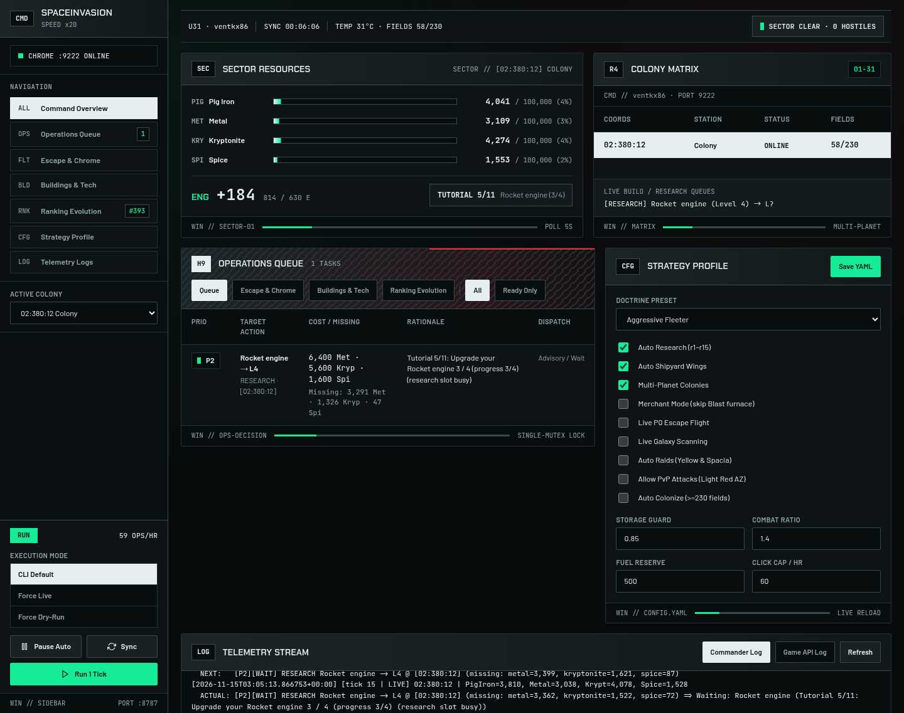

# SpaceInvasion Classic Autoplayer

Autonomous strategy engine (rule-based `priority` P0–P3 + full-horizon `ai_planner` + `config_opt`), topological Action Graph (`DAG`), append-only **PostgreSQL 16** universe observatory (40 tables via SQLAlchemy 2.0 ORM & Alembic migrations), local HTTP API, and modular React Operator Console for **SpaceInvasion Classic** (`https://spaceinvasion.bitmeup.com/?locale=en`).

See [docs/README.md](docs/README.md) for the full documentation portal, [docs/architecture.md](docs/architecture.md) for the modular runtime architecture, [docs/database-mer.md](docs/database-mer.md) for the 40-table PostgreSQL MER & Alembic migrations, [docs/api-commands.md](docs/api-commands.md) for the generated 60-command HTTP API catalog, [docs/settings-reference.md](docs/settings-reference.md) for all 50 `StrategyConfig` settings, and [AGENTS.md](AGENTS.md) for contributor/agent rules.

## Repository Structure

```text
spaceinvasion-autoplayer/
├── podman-compose.yml     # Podman 5-container stack (postgres, browser/noVNC, game_api, commander, frontend)
├── docker/                # Containerfiles (Containerfile.backend builds frontend into /opt/spaceinvasion-ui)
├── bin/                   # Container CLI entrypoints (game_api.py, commander.py, login.py)
├── backend/               # Modular Python package:
│   ├── core/              #   model.py, catalog/, settings/ (50-field schema), redaction/coercion/coords
│   ├── parsing/           #   Pure HTML/DOM parsers (overview, buildings, galaxy, spy, messages, fleet)
│   ├── combat/            #   1:1 simulator, Escape flight packer, 3/24h Bash tracker, colony grader, points
│   ├── planner/           #   heuristics/, ai/, config_opt/, graph/ (Kahn DAG), eta.py
│   ├── session/           #   auth.py, browser.py, limiter.py, browser_client/, exec_ops/
│   ├── db/                #   PostgreSQL 16 SQLAlchemy 2.0 ORM (models/, repos/, queries/, session.py, store.py) & Alembic
│   └── runtime/           #   api/ (declarative @command registry), bridge/ (published snapshots), commander/, reloader.py
├── frontend/              # Modular React + TypeScript + Vite Operator Console
├── scripts/               # Quality gates & utilities (check.py, generate_docs.py, enable_pg_stats.py, sync_wiki_data.py)
├── docs/                  # Unified docs (architecture, database-mer, manual, api-commands, settings-reference, specs)
├── notebooks/             # Offline strategy & optimizer notebooks (full_planner.ipynb, config_optimizer.ipynb)
└── tests/                 # Layered tests (tests/invariants/, tests/unit/, tests/e2e/)
```

## Architecture (3-Tier Stack on PostgreSQL 16)

```text
[Tier 3] bin/commander.py (--reload) / React Operator Console (:8787 or Vite :5173) / curl
             │  HTTP JSON (GET /health, /bot_status, /state, /dashboard; POST /command)
             ▼
[Tier 2] bin/game_api.py @ 127.0.0.1:8787 (--reload) ──► PostgreSQL 16 (40 tables, Alembic)
             │  Serialized browser lock (GameBrowserClient + ActionExecutor)
             ▼
[Tier 1] Persistent Chrome @ 127.0.0.1:9222 (browser container + noVNC :7900)
```

## Quickstart (Podman Stack)

1. Copy `.env.example` to `.env` and fill in your BitMeUp credentials (`SPACEINVASION_EMAIL`, `SPACEINVASION_PASSWORD`, `SPACEINVASION_UNIVERSE`).
2. Start all five containers:

```bash
podman-compose up -d --build
```

- **Operator Console**: `http://127.0.0.1:8787/` (built into `/opt/spaceinvasion-ui` inside `game_api`) or live Vite dev server at `http://127.0.0.1:5173/`.
- **Live Browser (noVNC)**: `http://127.0.0.1:7900/vnc.html?autoconnect=true&resize=scale` (for resolving login/CAPTCHA gates).
- **PostgreSQL 16**: `127.0.0.1:5433` (persisted in `./data/postgres`).

Strategy settings live directly in PostgreSQL (`strategy_config_store`), editable live from the Web Operator Console and documented in [docs/settings-reference.md](docs/settings-reference.md).



## Verification

```bash
# Static quality gates & doc drift checks
.venv/bin/python3 scripts/check.py --lint-only
.venv/bin/python3 scripts/generate_docs.py --check

# Frontend build & Vitest suite
npm --prefix frontend run build
npm --prefix frontend test

# Python invariants, unit & E2E suites (hermetic, disposable PostgreSQL 16)
.venv/bin/pytest -v tests/invariants/ tests/unit/
.venv/bin/pytest -v tests/e2e/
```
