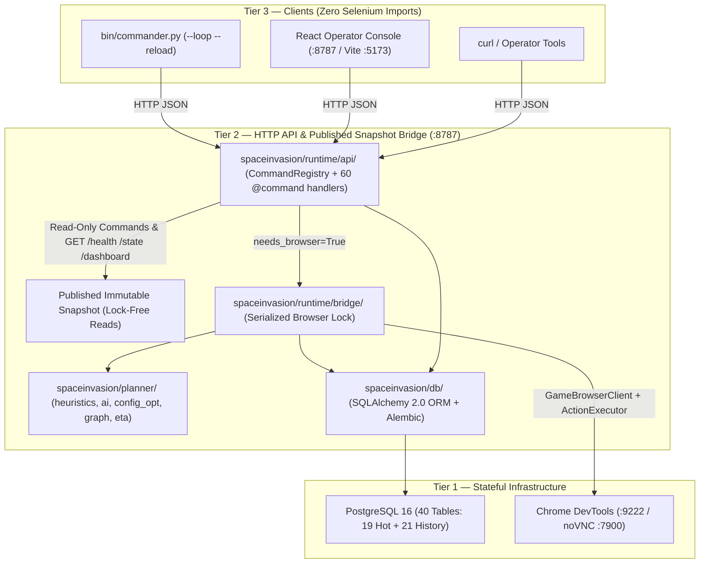

# SpaceInvasion Autoplayer — System Architecture Guide

This document describes the modular runtime architecture, package dependency boundaries, concurrency model, dual deployment modes (Docker/Podman & Host), and safety invariants of `spaceinvasion-autoplayer`.

---

## 1. Runtime Modes (Both on PostgreSQL 16)

Both supported runtime modes share the exact same Python codebase, PostgreSQL 16 schema, and React Operator Console — only process supervision differs.

| Aspect | Docker / Podman Mode | Host Mode |
|---|---|---|
| **Launch** | `podman-compose up -d` | `./starter.sh` (or `./starter.sh --dry-run`) |
| **Processes** | Five containers: `postgres`, `browser` (Chrome + noVNC `:7900`), `game_api` (`:8787`), `commander`, `frontend` (Vite `:5173`) | Host `bin/run_stack.py` supervising `bin/game_api.py --reload` (`:8787`) and `bin/commander.py --loop --reload`; host Chrome (`:9222`) |
| **Database** | PostgreSQL 16 (`postgres` container, persisted in `./data/postgres`) | Same `postgres` container (`127.0.0.1:5433`, auto-started by `starter.sh`) or external `SPACEINVASION_DB_URL` |
| **Operator Console** | Built into `/opt/spaceinvasion-ui` in `docker/Containerfile.backend` (`SPACEINVASION_UI_DIR=/opt/spaceinvasion-ui`, unaffected by `./spaceinvasion` bind mount) + live Vite dev server on `:5173` | Built automatically by `starter.sh` into `spaceinvasion/ui/` whenever `app.js` is missing or older than `frontend/` sources, served on `:8787` |



---

## 2. Package Architecture & Layering Rules

Dependencies flow strictly downward; the static layering tests enforce these boundaries automatically:

```text
bin/ (thin entrypoints: run_stack.py, game_api.py, commander.py, login.py)
  └── spaceinvasion/runtime/ (api/, bridge/, commander/, reloader.py)
        ├── spaceinvasion/session/ (auth.py, browser.py, limiter.py, browser_client/, exec_ops/)
        ├── spaceinvasion/planner/ (heuristics/, ai/, config_opt/, graph/, eta.py)
        ├── spaceinvasion/db/      (models/, repos/, queries/, dto/, session.py, store.py, alembic_migrations/)
        ├── spaceinvasion/combat/  (simulator, cargo, flight, raid, bash, colony, scan, points)
        ├── spaceinvasion/parsing/ (pure HTML/DOM parsers: overview, buildings, research, galaxy, spy, messages, fleet)
        └── spaceinvasion/core/    (model.py, catalog/, settings/, redaction.py, coercion.py, coords.py)
```

Key architectural invariants:
- **`spaceinvasion/core/`** depends only on the Python standard library. It owns `model.py` dataclasses, the generated game catalog (`catalog/`), and the single-source 50-field settings schema (`settings/`).
- **`spaceinvasion/parsing/`** and **`spaceinvasion/combat/`** are pure domain logic with zero Selenium, HTTP, or database imports.
- **`spaceinvasion/session/`** owns browser/frame navigation (`browser_client/`), token-bucket pacing (`limiter.py`), and DOM action execution (`exec_ops/`), with zero `planner`, `combat`, `db`, or `runtime` imports.
- **`spaceinvasion/db/`** is the sole owner of SQLAlchemy 2.0 and `psycopg` imports. ORM objects never cross out of `db/`; repositories return immutable DTOs from `db/dto/`.
- **`spaceinvasion/planner/`** provides two autonomous engines (`priority` deterministic P0–P3 heuristics in `planner/heuristics/` and full-horizon `ai_planner` in `planner/ai/`), backed by `planner/config_opt/` (long-term planet/warehouse target optimizer) and `planner/graph/` (Kahn dependency DAG builder).

---

## 3. Concurrency, Locking & Lock-Free Read Path

- **Serialized Browser Lock**: Chrome `:9222` is strictly single-writer. `CommandRegistry` inspects each command's declarative `needs_browser` flag and acquires the browser lock **only** when `needs_browser=True`.
- **Lock-Free Published Snapshots**: After every state change, config patch, or queue mutation, the bridge publishes a fresh immutable snapshot. `GET /health`, `GET /bot_status`, `GET /state`, `GET /dashboard`, and all 33 read-only/DB `POST /command` handlers read directly from the published snapshot or PostgreSQL without ever waiting on an in-flight Selenium page load.
- **Page-View Rate Limiter**: `spaceinvasion/session/limiter.py` enforces per-minute page-view budgets with reserved interactive capacity so background galaxy sweeps yield cleanly to live commander actions.

---

## 4. Operator Console (`frontend/`)

- Modular React + TypeScript + Vite application (`frontend/src/`) split by domain feature (`dashboard`, `operations`, `buildings`, `research`, `action-graph`, `combat`, `fleet-control`, `sectors`, `espionage`, `colonies`, `attacks`, `recyclers`, `ranking`, `config`, `logs`).
- **Single-source settings UI**: Settings panels render from the schema exported by `spaceinvasion.core.settings`, eliminating duplicated field bounds and help strings.
- **Typed API payloads**: TypeScript payload contracts are generated from Python payload definitions (`spaceinvasion/runtime/api/payloads/`).
- **Bundle builds**:
  - **Host mode**: `starter.sh` checks whether `spaceinvasion/ui/app.js` is missing or older than `frontend/src/`, `frontend/index.html`, `frontend/package.json`, or `frontend/vite.config.ts` and runs `npm --prefix frontend run build` automatically.
  - **Docker mode**: `docker/Containerfile.backend` runs a Node 22 build stage into `/opt/spaceinvasion-ui` and sets `SPACEINVASION_UI_DIR=/opt/spaceinvasion-ui`.

---

## 5. Hot-Reload & Security Guardrails

- **Hot-reload write order**: Edit leaf packages (`core/`, `parsing/`, `db/`, `combat/`) before editing `planner/`, `session/`, `runtime/`, or `bin/` so `--reload` subprocesses never restart on broken imports.
- **Anti-bot safety (CAPTCHA / Turnstile / 2FA)**: `PageGuardChecker` raises `AntiBotChallengeError` immediately on any challenge page. Automation pauses cleanly, persists a `captcha_gate` UI notification, and waits passively (`GET /bot_status`, zero browser calls) until the operator resolves the gate in Chrome (or noVNC `:7900`) and clicks Resume. `starter.sh` never auto-restarts on exit code `2`.
- **Secret & session redaction**: `spaceinvasion/core/redaction.py` strips `sid=<token>`, `PHPSESSID`, and credential tokens across logs, diagnostics, and persisted DB text. `.env`, `.sessions/`, `.browser_profile/`, `data/`, `state/`, and `logs/` remain strictly untracked.
