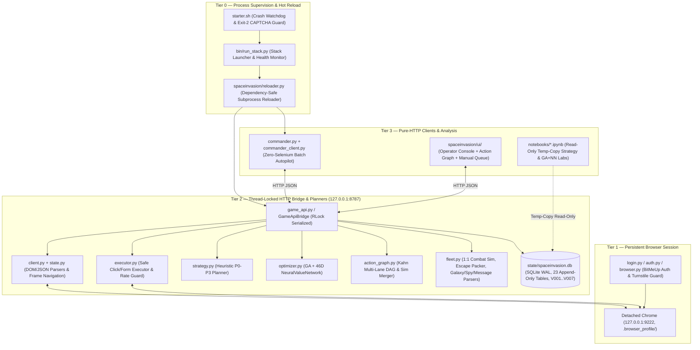

# System & Runtime Architecture

`spaceinvasion-autoplayer` is engineered around a strict **3-tier decoupled runtime** so browser session state, decision/optimization algorithms, persistent telemetry, and the operator web console never race each other or duplicate browser connections.

---

## 1. High-Level 3-Tier Topology



---

## 2. Tier Responsibilities & Isolation Boundaries

### Tier 0 — Supervision & Hot-Reload (`starter.sh`, `bin/run_stack.py`, `reloader.py`)
- **`starter.sh`**: Outer POSIX/Bash watchdog at the repository root that restarts `bin/run_stack.py` with exponential backoff (`5s -> 60s` max, resetting after `>= 60s` healthy uptime) if Python crashes, cleans up orphaned port-`8787` children, and **halts immediately without restarting on exit code `2`** (anti-bot / Cloudflare Turnstile challenge).
- **`bin/run_stack.py`**: Verifies Chrome DevTools readiness on `127.0.0.1:9222`, starts `bin/game_api.py --reload`, waits for `GET /health == 200`, and starts `bin/commander.py --loop --reload`.
- **Bottom-Up Hot-Reload Invariant**: `reloader.py` watches leaf domain modules (`game_data.py`, `state.py`, `fleet.py`, `ranking.py`, `action_graph.py`, `storage.py`) and restarts `game_api.py` / `commander.py` cleanly without closing Chrome.

### Tier 1 — Browser & Session Layer (`login.py`, `browser.py`, `auth.py`, `client.py`)
- Launches Google Chrome with `--remote-debugging-port=9222` backed by a persistent local profile (`.browser_profile/`).
- Chrome stays open independently of Python restarts so active BitMeUp sessions survive code reloads.
- **Single-Client Rule**: Only `GameApiBridge` connects Selenium to `127.0.0.1:9222`. All automation loops, CLI checks, and UI actions route through `http://127.0.0.1:8787`.
- **Anti-Bot / CAPTCHA Guard**: `auth.py` and `client.py` inspect both inner frames (`#F_Hauptframe`, `#F_planets`) and the outer `indexGame.es` shell for Cloudflare Turnstile / CAPTCHA challenges (including German `Sicherheitsprüfung` modals), raising `AntiBotChallengeError` (`HTTP 503` -> Commander exit code `2`).

### Tier 2 — HTTP Bridge, Planning Engines & Storage (`api_server.py`)
- **`GameApiBridge._lock`**: Serializes all Selenium frame transitions, DOM reads, and click executions across concurrent UI requests and `commander.py` ticks.
- **State & Inbox Synchronization**: Parses `#json-container`, `internalBuildings`, `internalResearch`, `internalWeaponFactory`, `internalEconomy`, `internalGalaxy` (2D `div.planet-hit` + classic table), and `internalMessages` (archiving spy, battle, recycle, and fleet messages into append-only SQLite tables before optional in-game cleanup).
- **Dual Planning Modes (`StrategyConfig.planner_mode`)**:
  1. **`"priority"` (`spaceinvasion/strategy.py`)**: Deterministic `P0 -> P3` heuristic planner (`P0` hostile fleet alerts & escape flights -> `P1` emergency energy/smelter throttle/tutorial claim/warehouse cap relief -> `P2` mine/fusion/tech/raid ROI -> `P3` shipyard/recon/advisories).
  2. **`"ga_nn"` (`spaceinvasion/optimizer.py`)**: Evolutionary horizon planner combining a fixed-horizon `SimAction` Genetic Algorithm (`_SimState` forward simulator) with an online 46-input `NeuralValueNetwork` (`TorchMLP` or zero-dependency `PurePythonMLP`).
- **Topological Action Graph Engine (`spaceinvasion/action_graph.py`)**:
  - Converts any `PlannedAction` list (plus optional `OptimizerRunSummary.best_simulation.step_outcomes`) into a multi-lane Directed Acyclic Graph (`lanes`, `nodes`, `edges`, `summary`) using Kahn longest-path layering (`topological_layer`: `L0 < L1 < ...`).
  - Infers **11 typed dependency/sequence edge classes**: `slot_order` / `queue_order`, `ga_step_order`, `level_chain`, `resource_feed` (including `2:1` Pig iron -> Blast furnace), `loot_feed`, `energy_supply`, `storage_cap`, `prereq_building`, `prereq_tech`, `recon_intel`, `fleet_prep`, `hostile_defense`, and `tutorial_step`.
  - Supports **isolated simulation previews** (`merge_strategy_config_overrides` + `run_optimizer(..., record_global_summary=False)`) with **zero browser page views** and **zero active `StrategyConfig` mutation**.
  - Memoizes JSON-cloned active graphs via deep `_freeze_sig_tree` signatures so 5-planet `GET /dashboard?refresh=0` completes in **`~13.6ms`** (`< 25ms` SLA).

### Tier 3 — Pure-HTTP Commander & Web Operator Console
- **`commander.py`**: Pure-HTTP batch autopilot with **zero Selenium imports**. Accumulates ready actions (`manual_queue` `P0`/`P1` items first, then planner actions), respects `action_batch_interval_seconds` and exact build/queue wakeup timers to minimize browser page views, tracks per-colony fleet-slot cooldowns (`1 + Fleet base b10`), and halts immediately (`exit 2`) on `AntiBotChallengeError`.
- **`spaceinvasion/ui/` (`index.html`, `styles.css`, `app.js`)**: Single-page operator console served at `http://127.0.0.1:8787/` providing:
  - **Overview & Colony Telemetry** (resources, queues, `GA+NN` convergence HUD, ranking evolution chart)
  - **Action Graph & Right-Side Parameter Simulation Panel** (`#view-action-graph` + `#ag-control-panel`: `"priority"` <-> `"ga_nn"` switcher, SVG cubic Bezier DAG canvas, `180ms`-debounced preview across `28` controls, `Reset to Active`, and explicit `Apply to Active Config`)
  - **Manual Command Queue** (`P0`..`P3` pinning, reordering, resource reservation)
  - **Espionage Intel**, **Possible Colonies** (`S`/`A+`/`A`/`B`/`C`/`D` grading, `300+` field filter), **Attack Results**, **Recycler & Inbox**, and **Live Redacted Logs**.

---

## 3. End-to-End Request & Tick Sequence

```mermaid
sequenceDiagram
    autonumber
    participant UI as Operator UI (Browser)
    participant CMD as commander.py (Tier 3)
    participant API as GameApiBridge :8787 (Tier 2)
    participant OPT as strategy.py / optimizer.py / action_graph.py
    participant DB as SQLite WAL (spaceinvasion.db)
    participant CH as Chrome :9222 (SpaceInvasion)

    Note over CMD,CH: Automated Batch Execution Cycle
    CMD->>API: GET /state?include_buildings=1
    API->>CH: Read #json-container + active queues + unread inbox
    CH-->>API: Parsed GameState + new spy/battle/recycle reports
    API->>DB: Append snapshots & ingested reports (WAL)
    API-->>CMD: Sanitized GameState JSON
    CMD->>API: POST /command {"command": "plan"}
    API->>OPT: Merge manual_queue + run priority or ga_nn planner
    OPT-->>API: PlannedAction[] + ETAs + OptimizerRunSummary
    API-->>CMD: Ordered actions
    CMD->>API: POST /command {"command": "build" / "attack" / ...}
    API->>CH: Execute safe DOM click / form submit
    API->>DB: Append action_history (+ raid_history / bash_blocks)
    API-->>CMD: Execution outcome + next wakeup timer

    Note over UI,OPT: Zero-Page-View Action Graph Parameter Simulation
    UI->>API: POST /command {"command": "action_graph", "simulated": true, "refresh": false, "config": {...}}
    API->>OPT: merge_strategy_config_overrides + run_optimizer(record_global_summary=False)
    OPT->>OPT: build_action_graph (Kahn DAG layers + 11 edge types)
    OPT-->>API: Ephemeral Action Graph JSON (active StrategyConfig untouched)
    API-->>UI: Render SVG Bezier DAG + diff badge (0 Chrome page views)
```

---

## 4. Security, Privacy & Domain Invariants

1. **Zero Secret Leakage**: `.env`, `.sessions/`, and `.browser_profile/` are gitignored and never read by UI/log endpoints. `redact_sensitive` (`spaceinvasion/logging_utils.py`) masks all `sid=<token>` query parameters and `<input name="sid" value="...">` HTML attributes across logs, crash traces, SQLite rows, and API responses.
2. **Append-Only Telemetry**: Historical rows in `state/spaceinvasion.db` are never deleted so long-term universe economics, espionage histories, and combat distributions remain intact for offline modeling in `notebooks/`.
3. **SpaceInvasion Classic Physics**:
   - **Merchant Parity**: `6 Pig Iron : 2.5 Metal : 3 Kryptonite : 1 Spice`.
   - **Blast Furnace (`b2`)**: Consumes `2 : 1` Pig iron per Metal, is **not** boosted by `r1` Mining technology, and is automatically throttled to `0%` when Metal storage is full while Pig iron storage still has free capacity.
   - **Planetary Energy & Fields**: `forbid_planetary_solar: true` reserves `Thermosolar plant` (`b6`) and `Solar cells` (`s9`) strictly for Asteroids and demolishes legacy planetary `b6` down to `L0` once `Fusion plant` (`b5`) + `r2` Energy technology cover demand.
   - **Combat & Bash Regulation**: `1:1` targeting (zero rapidfire); `3 attacks / 24h` per planet with server-enforced `Attack-Bash-Regulations` countdowns persisted in `bash_blocks` / `spy_targets.blocked_until_ts`.
