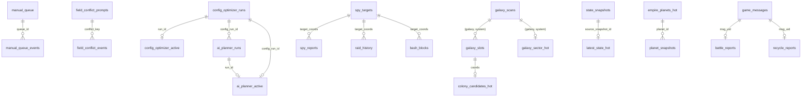

# SpaceInvasion Autoplayer — PostgreSQL Database MER & Migration Architecture

`spaceinvasion-autoplayer` uses **PostgreSQL 16 exclusively** inside the Podman stack through a typed **SQLAlchemy 2.0 ORM** layer (`backend/db/`) and **Alembic** schema migrations (`backend/db/migrations/`). All telemetry, history, and audit tables are strictly **append-only** (zero destructive `DELETE FROM` or `DROP TABLE` operations).

---

## 1. Database Layer Modules (`backend/db/`)

| Module | Responsibility |
|---|---|
| `backend/db/models/` | Typed SQLAlchemy 2.0 declarative models covering all **40 PostgreSQL tables**, grouped by family (`colonies`, `galaxy`, `intel`, `messages`, `notifications`, `planner_runs`, `queue`, `raids`, `settings`, `snapshots`, `telemetry`). All relationships set `lazy="raise_on_sql"`. |
| `backend/db/session.py` | Pooled `DatabaseEngine` (`psycopg` 3 driver), `statement_timeout` enforcement, atomic `UnitOfWork` / `db_uow`, and `count_statements` test instrumentation. |
| `backend/db/repos/` | 11 domain repositories (`ColoniesRepository`, `GalaxyRepository`, `IntelRepository`, `ManualQueueRepository`, `MessagesRepository`, `NotificationsRepository`, `PlannerRunsRepository`, `RaidsRepository`, `SettingsRepository`, `SnapshotsRepository`, `TelemetryRepository`) using batched `INSERT ... ON CONFLICT` upserts and returning immutable DTOs. |
| `backend/db/queries/` | Set-based SQLAlchemy read queries (`colonies`, `dashboard`, `galaxy`, `intel`, `raids`) pushing aggregation and ranking into PostgreSQL. |
| `backend/db/dto/` | Immutable dataclass records crossing the `db/` package boundary (ORM entities never leak outside `db/`). |
| `backend/db/store.py` | `DatabaseStore` composition root wiring `DatabaseEngine`, Alembic `ensure_ready`, repositories, and `summary()` / `verify()`. |
| `backend/db/migrations/` | Programmatic Alembic runner (`upgrade_database` with mandatory pre-upgrade `pg_dump` backup callback, `stamp_baseline_database`, `verify_models_match_migrations`) and versioned revision scripts (`versions/0001..0004`). |

---

## 2. Entity-Relationship Overview (`erDiagram`)



---

## 3. Complete 40-Table Inventory (19 Hot + 21 History)

### Hot / Materialized State Tables (19 Tables)

| # | Table | Primary Key | Purpose |
|---:|---|---|---|
| 1 | `meta` | `key` | Runtime key-value metadata, debris caches, and operational markers. |
| 2 | `latest_state_hot` | `id` (`= 1`) | Singleton materialized latest full game-state and plan snapshot. |
| 3 | `empire_planets_hot` | `planet_id` | Materialized active/inactive owned empire planets and resource levels. |
| 4 | `galaxy_sector_hot` | `(galaxy, system)` | Materialized per-sector scan counts, owners, Spacia coords, and prime slots. |
| 5 | `colony_candidates_hot` | `coords` | Materialized graded uninhabited colony candidates (`is_probed`, `max_fields_est`). |
| 6 | `strategy_config_store` | `id` (`= 1`) | Singleton persisted `StrategyConfig` JSON document (50 canonical settings). |
| 7 | `economy_rates_cache` | `planet_id` | Cached per-planet mine/power production throttle percentages. |
| 8 | `tutorial_progress` | `step` | Observed SpaceInvasion tutorial step milestones and completion timestamps. |
| 9 | `spy_targets` | `coords` | Current espionage dossier, resources, fleet/defense intel, and bash cooldowns. |
| 10 | `galaxy_scans` | `(galaxy, system)` | Latest scan timestamp and slot counts for each galaxy sector. |
| 11 | `galaxy_slots` | `coords` | Current known state of every scanned coordinate slot across G1–G14. |
| 12 | `ui_notifications` | `id` | Deduplicated persistent operator console alerts (`unread`, `read`, `dismissed`). |
| 13 | `universe_research_max` | `research_key` | Monotonic highest observed universe research level per technology key. |
| 14 | `manual_queue` | `id` | Operator-queued manual commands (`pending`, `ready`, `completed`, `canceled`). |
| 15 | `config_optimizer_active` | `singleton_id` (`= 1`) | Active Config Optimizer targets, planet specializations, and reserved floors. |
| 16 | `ai_planner_active` | `singleton_id` (`= 1`) | Active full-horizon AI-Planner schedule, KPI summary, and parameters. |
| 17 | `field_conflict_prompts` | `conflict_key` | Active/resolved colony building field-capacity conflict prompts. |
| 18 | `loot_recycle_hourly` | `hour_bucket` | Hourly aggregated stolen combat loot and recycled debris rollups. |
| 19 | `schema_migrations` | `version` | Legacy migration checksum ledger (preserved append-only alongside `alembic_version`). |

### Append-Only History & Audit Tables (21 Tables)

| # | Table | Primary Key | Purpose |
|---:|---|---|---|
| 20 | `rank_snapshots` | `id` | Account rank, points, points/hour, and empire spice-value time series. |
| 21 | `planet_snapshots` | `id` | Per-planet resource, building, ship, defense, and research snapshots. |
| 22 | `state_snapshots` | `id` | Full serialized empire state and plan archive. |
| 23 | `action_history` | `id` | Audit log of executed and dry-run commander/operator actions. |
| 24 | `config_history` | `id` | Immutable history of `StrategyConfig` revisions. |
| 25 | `spy_reports` | `id` | Append-only archive of parsed espionage reports (`buildings`/`fleet`/`defense`/`researches`). |
| 26 | `galaxy_scan_history` | `id` | Append-only history of galaxy system scans. |
| 27 | `galaxy_slot_history` | `id` | Append-only observations of individual galaxy slot state transitions. |
| 28 | `raid_history` | `id` | Append-only ledger of dispatched raids, exemptions, and outcomes (3/24h Bash tracking). |
| 29 | `bash_blocks` | `id` | Append-only ledger of server bash-limit and protection cooldown blocks. |
| 30 | `game_messages` | `id` (`msg_uid` unique) | Archive of raw and parsed BitMeUp inbox messages. |
| 31 | `battle_reports` | `id` (`msg_uid` unique) | Structured combat report ledger (loot, losses, created debris). |
| 32 | `recycle_reports` | `id` (`msg_uid` unique) | Structured debris-harvesting ledger from recycler reports. |
| 33 | `manual_queue_events` | `id` | Append-only lifecycle events linked to `manual_queue.id`. |
| 34 | `universe_research_max_history` | `id` | Audit history of universe research maximum refreshes. |
| 35 | `colony_attempts` | `id` | Audit trail of colony ship dispatches, field rolls, keeps, and abandonments. |
| 36 | `config_optimizer_runs` | `id` | Append-only archive of Config Optimizer simulation runs. |
| 37 | `ai_planner_runs` | `id` | Append-only archive of AI-Planner optimization runs. |
| 38 | `field_conflict_events` | `id` | Append-only history of field-conflict prompt creation and operator decisions. |
| 39 | `hourly_production_history` | `id` (`minute_bucket` unique) | Minute-bucketed empire resource production rates and active builders. |
| 40 | `schema_migration_events` | `id` | Append-only audit log of every Alembic `APPLY` and `STAMP_BASELINE` event with SHA-256 checksums and backup paths. |

---

## 4. Alembic Migrations & Native PostgreSQL Tuning

Schema evolution is managed exclusively by **Alembic** (`backend/db/migrations/`). Every upgrade records an audit row in `schema_migration_events` and requires an explicit `pg_dump` backup callback before executing DDL.

| Revision | Script | Summary |
|---|---|---|
| `0001` | `0001_baseline_schema.py` | Exact 40-table PostgreSQL baseline schema; existing databases stamp `0001` with zero table DDL (`stamp_baseline_database`). |
| `0002` | `0002_jsonb_payload_columns.py` | Converts 43 structured domain `*_json` payload columns from `TEXT` to native PostgreSQL `JSONB` (lossless `downgrade()` back to `TEXT`). |
| `0003` | `0003_foreign_keys_and_checks.py` | Adds 6 verified parent-child foreign keys and 32 `CHECK` constraints on 0/1 flags, status/priority/severity enums, and coordinate bounds (lossless `downgrade()`). |
| `0004` | `0004_composite_partial_brin_indexes.py` | Adds 24 measured composite, partial (active `spy_targets`, `colony_candidates_hot`, pending `manual_queue`, unread `ui_notifications`, executed `action_history`), and `BRIN` indexes on append-only history tables (`pg_stat_statements` & `EXPLAIN ANALYZE` verified `< 50 ms` with zero large-table `Seq Scan`s). |

### Statement Performance Monitoring (`pg_stat_statements`)

`podman-compose.yml` configures PostgreSQL 16 with `shared_preload_libraries=pg_stat_statements` and `log_min_duration_statement=50`. Inspect live query rankings read-only with:

```bash
.venv/bin/python3 scripts/enable_pg_stats.py --report --limit 40
```
