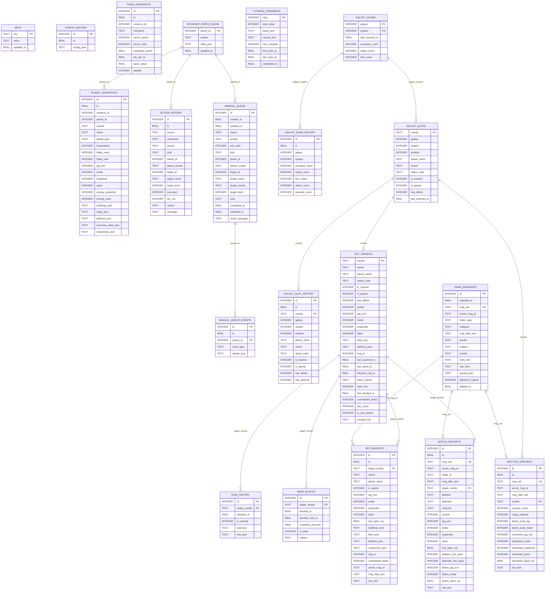

# Database Entity-Relationship Model (MER / DER)

Complete data model and schema documentation for `state/spaceinvasion.db` (`spaceinvasion/storage.py`) and its sanitized JSON mirror `data/attack_history.json`.

---

## 1. Storage Architecture & Core Design Rules

1. **SQLite WAL Mode + Thread Lock**: `GameDatabase` (`spaceinvasion/storage.py`) opens `state/spaceinvasion.db` with `PRAGMA journal_mode=WAL`, `PRAGMA synchronous=NORMAL`, and `PRAGMA foreign_keys=ON`, guarded by an internal `threading.RLock` for thread-safe concurrent access inside `GameApiBridge`.
2. **Append-Only Historical Retention**: Event and snapshot tables (`rank_snapshots`, `planet_snapshots`, `action_history`, `config_history`, `galaxy_scan_history`, `galaxy_slot_history`, `spy_reports`, `game_messages`, `raid_history`, `bash_blocks`, `battle_reports`, `recycle_reports`, `manual_queue_events`) **never delete historical rows**, preserving complete longitudinal universe telemetry for offline analytics and machine-learning/GA training.
3. **Soft Flags Over Destructive Deletes**: Current-state lookup tables (`spy_targets`, `manual_queue`, `game_messages`) use non-destructive lifecycle columns (`is_own_planet`, `merged_into`, `status`, `completed_ts`, `canceled_ts`, `deleted_in_game`, `deleted_ts`) rather than `DELETE`.
4. **Automatic Secret Redaction**: Every text/JSON write passes through `redact_sensitive` and finite-number coercion so `sid=` session tokens, `NaN`, and `Infinity` never enter SQLite or `data/attack_history.json`.

---

## 2. Entity-Relationship Diagram (MER)

> **Relationship Convention**: SQLite coordinates (`coords` / `target_coords` formatted as `GG:SSS:PP`), `planet_id`, `(galaxy, system)`, `msg_uid`, and `queue_id` form the logical entity relationships across the 20 tables.

---

## 3. Complete Table Dictionary (20 Tables)

### 3.1 Empire State, Economy & Configuration

| Table | Pattern | Primary Key | Description & JSON Columns |
|---|---|---|---|
| `meta` | Upsert KV | `key` | Schema version (`schema_version`) and database metadata flags. |
| `config_history` | Append-only | `id` | Immutable audit log of every `StrategyConfig` snapshot (`config_json`). |
| `rank_snapshots` | Append-only | `id` | Time-series account progression: server points/rank, estimated build+tech+fleet points, `pts_per_hr`, total `spice_value`, and colony count. |
| `planet_snapshots` | Append-only | `id` | Time-series colony snapshots: resources, energy (`energy_produced`, `energy_used`), field usage, `buildings_json`, `ships_json`, `defense_json`, `economy_rates_json`, and `researches_json`. |
| `state_snapshots` | Append-only | `id` | Full `GameState` + planned-action snapshots (`source`, `universe_id`, `user_id`, `nickname`, `active_planet_id`, `planet_count`, `planned_action_count`, `state_json`, `plan_json`), consolidating legacy `state/snapshot.json` into SQLite. |
| `economy_rates_cache` | Upsert State | `planet_id` | Latest persisted `internalEconomy` slider percentages (`resource1..resource6` in `rates_json`) per owned colony. |
| `tutorial_progress` | Upsert State | `step` | Tutorial steps `1..11`, task checklist (`tasks_json`), reward text, claim readiness, and completion timestamps. |

### 3.2 Action Audit Log & Manual Operator Queue

| Table | Pattern | Primary Key | Description & Lifecycle |
|---|---|---|---|
| `action_history` | Append-only | `id` | Every live or dry-run command attempted by `commander.py` or the Operator UI (`source`, `command`, `priority`, `kind`, `planet_id`, `target_id`, `target_name`, `target_level`, `executed`, `dry_run`, `reason`, `message`). |
| `manual_queue` | Soft-state | `id` | Operator-enqueued manual commands (`status` in `pending` / `completed` / `canceled`, `priority` `P0`..`P3`, `sort_rank`). `P0`/`P1` pending items reserve colony resources and execute ahead of automated plans. |
| `manual_queue_events` | Append-only | `id` | Immutable audit trail of queue mutations (`enqueued`, `updated`, `reordered`, `completed`, `canceled`) linked via `queue_id -> manual_queue.id`. |

### 3.3 Galaxy Cartography & Colonization

| Table | Pattern | Primary Key | Description |
|---|---|---|---|
| `galaxy_scans` | Upsert State | `(galaxy, system)` | Latest scan timestamp and slot counts (`occupied_count`, `target_count`, `free_count`) per solar system so `commander.py` prioritizes unscanned/stale systems. |
| `galaxy_scan_history` | Append-only | `id` | Historical log of every solar-system scan including `debris_count` and `asteroid_count`. |
| `galaxy_slots` | Upsert State | `coords` | Latest known state of each `GG:SSS:PP` orbital slot (`free`, `yellow` inactive, `blue` protected, `red` banned/vacation, `is_spacia`, `has_debris`). Powers colony slot selection and grading. |
| `galaxy_slot_history` | Append-only | `id` | Longitudinal history of orbital slot ownership, inactivity transitions, debris appearance, and asteroids. |

### 3.4 Espionage & Target Registry

| Table | Pattern | Primary Key | Description & Non-Destructive Flags |
|---|---|---|---|
| `spy_targets` | Upsert State | `coords` | Master target table merging galaxy scan status with latest espionage intelligence (`pig_iron..spice`, `fleet_json`, `defense_json`, `dug_in`, `uninhabited_fields`, `spy_count`), bash cooldowns (`blocked_until_ts`, `block_reason`, `bash_hits`), and soft flags (`is_own_planet`, `merged_into`). |
| `spy_reports` | Append-only | `id` | Every individual espionage report ever ingested (`target_coords`, 4 resources + `loot_spice_eq`, `buildings_json`, `fleet_json`, `defense_json`, `researches_json`, `uninhabited_fields`, `server_msg_id`, `msg_date_text`). Powers colony size grading (`S`/`A+`/`A` for `300+` fields) and farm depletion curves. |

### 3.5 In-Game Messages, Combat, Bash Blocks & Recycling

| Table | Pattern | Primary Key / Unique | Description |
|---|---|---|---|
| `game_messages` | Append-only + Soft flag | `id` (`msg_uid` `UNIQUE`) | Full archive of every `internalMessages` item (`spy_report`, `battle_report`, `recycle_report`, `fleet_return`, `other`) with `body_text`, sanitized `raw_html`, structured `parsed_json`, and `deleted_in_game` / `deleted_ts` tracking after in-game inbox cleanup. |
| `raid_history` | Append-only | `id` | Dispatched attack log (`target_coords`, `attacked_ts`, `is_exempt`, `outcome`, `loot_json`), feeding `BashTracker` (`3/24h` active-player bash limit) and `ga_nn` historical win-rate priors. |
| `bash_blocks` | Append-only | `id` | Server-enforced mission blocks parsed from `internalSendFleet` banners (e.g. `Attack-Bash-Regulations: 3 attacks in 24 hours • Reset in HH:MM:SS`), overriding `is_spacia` / `is_inactive` exemptions until `blocked_until_ts`. |
| `battle_reports` | Append-only | `id` (`msg_uid` `UNIQUE`) | Resolved combat outcomes (`win` / `loss`, `rounds`), exact 4-resource plunder (`pig_iron..spice`, `loot_spice_eq`), fleet losses (`attacker_lost_spice`, `defender_lost_spice`), and spawned orbital rubble (`debris_pig_iron`, `debris_metal`, `debris_spice_eq`). |
| `recycle_reports` | Append-only | `id` (`msg_uid` `UNIQUE`) | Resolved `Recycler` (`s11`) harvests (`coords`, `recycler_count`, `debris_avail_pig`, `debris_avail_metal`, 4 harvested resources + `harvested_spice_eq`). |

---

## 4. Secondary Index Catalog (16 Indexes)

| Index Name | Table & Columns | Query Accelerated |
|---|---|---|
| `idx_rank_snapshots_ts` | `rank_snapshots(ts)` | Ranking evolution charts & pts/hr trend windowing |
| `idx_planet_snapshots_pid_ts` | `planet_snapshots(planet_id, ts)` | Per-colony resource/infrastructure time-series lookups |
| `idx_action_history_ts` | `action_history(ts)` | Recent executed actions & hourly rate-cap audit |
| `idx_spy_reports_coords_ts` | `spy_reports(target_coords, ts)` | Per-target espionage history & latest `uninhabited_fields` |
| `idx_game_messages_ts` | `game_messages(ingested_ts)` | Chronological inbox feed in Operator Console |
| `idx_game_messages_coords` | `game_messages(coords, ingested_ts)` | Coordinate-filtered message history |
| `idx_game_messages_cat` | `game_messages(category, ingested_ts)` | Category tabs (`spy_report`, `battle_report`, `recycle_report`) |
| `idx_galaxy_scans_ts` | `galaxy_scans(last_scanned_ts)` | Oldest-scanned solar-system selection |
| `idx_galaxy_scan_history_sys_ts` | `galaxy_scan_history(galaxy, system, ts)` | System activity trend analysis |
| `idx_galaxy_slots_sys` | `galaxy_slots(galaxy, system, position)` | Solar-system map reconstruction & colony slot search |
| `idx_galaxy_slot_history_coords_ts` | `galaxy_slot_history(coords, ts)` | Player inactivity transition detection |
| `idx_config_history_ts` | `config_history(ts)` | Configuration change timeline |
| `idx_raid_history_coords_ts` | `raid_history(target_coords, attacked_ts)` | Rolling 24h `BashTracker` window & per-target raid stats |
| `idx_bash_blocks_coords_ts` | `bash_blocks(target_coords, blocked_ts)` | Active server bash-cooldown lookup |
| `idx_battle_reports_coords_ts` | `battle_reports(target_coords, ts)` | Per-target win rate & loot mean/std in `full_planner.ipynb` |
| `idx_recycle_reports_coords_ts` | `recycle_reports(coords, ts)` | Debris-field harvest history |
| `idx_schema_migration_events_ts` | `schema_migration_events(ts)` | Chronological schema upgrade & backup audit trail |
| `idx_spy_targets_colony_filter` | `spy_targets(is_own_planet, merged_into, is_spacia, is_inactive)` | Colony candidate & active raid target filtering |
| `idx_battle_reports_ts` | `battle_reports(ts)` | Chronological attack result feeds |
| `idx_recycle_reports_ts` | `recycle_reports(ts)` | Chronological recycler harvest feeds |
| `idx_state_snapshots_ts` | `state_snapshots(ts)` | Chronological full-state & plan snapshot lookups |

---

## 5. Schema Versioning & Forward-Only Migrations (`spaceinvasion/migrations.py`)

All SQLite databases (`state/spaceinvasion.db` plus any auxiliary `state/*.db` stores) are versioned and migrated non-destructively via `MigrationRunner` and `DatabaseMigrationRegistry` (`spaceinvasion/migrations.py`, CLI `scripts/db_migrate.py`):

| Ledger Table | Pattern | Primary Key | Description |
|---|---|---|---|
| `schema_migrations` | Append-only | `version` | Authoritative ledger of applied forward migrations (`V001..V007`), storing `version_tag`, `name`, `description`, deterministic SHA-256 DDL `checksum`, `applied_ts`, `duration_ms`, and `details_json` (e.g. `added_columns`). |
| `schema_migration_events` | Append-only | `id` | Immutable audit log of every `migration_applied` and `backup_created` event (`from_version`, `to_version`, `backup_path`, `details_json`). |

- **Triple-Synced Version Markers**: Every applied migration synchronizes `schema_migrations.version`, `meta` (`schema_version`, `schema_version_tag`, `schema_checksum`), and SQLite's binary header `PRAGMA user_version = 7`.
- **Savepoint-Isolated Execution & Online Backups**: Individual migrations execute via `conn.execute(...)` inside per-version SQLite `SAVEPOINT`s (preserving transactional DDL rollback on failure) and automatically create hot WAL-consistent backups in `state/backups/` via `sqlite3.Connection.backup` before upgrading `state/spaceinvasion.db`.
- **CLI & HTTP API Commands**:
  - CLI: `.venv/bin/python3 scripts/db_migrate.py {status,migrate,verify,backup,history} [--all] [--dry-run] [--backup] [--json]`
  - HTTP `POST /command`: `db_migrations`, `db_migrate`, `db_backup`, `db_verify`, `state_snapshots`.

---

## 6. Legacy JSON Sidecar Retirement & Safe Offline Access

- **SQLite-Only Persistence (`V006` & `V007`)**: All three legacy JSON sidecars (`data/attack_history.json`, `state/rank_history.json`, and `state/snapshot.json`) have been retired into SQLite (`raid_history`, `bash_blocks`, `rank_snapshots`, `state_snapshots`, and `planet_snapshots`, with audit metadata recorded in `meta`). `spaceinvasion/optimizer.py` (`load_attack_history_stats`) and `spaceinvasion/ranking.py` (`load_rank_history`) read directly from isolated temporary copies of `state/spaceinvasion.db`.
- **Read-Only Notebook Pattern**: When inspecting `state/spaceinvasion.db` from external scripts or Jupyter notebooks (`notebooks/optimizer_experimentation.ipynb`, `notebooks/full_planner.ipynb`), always copy `spaceinvasion.db` plus `-wal`, `-shm`, and `-journal` sidecars into a `tempfile.TemporaryDirectory()` before opening SQLite so the live `GameApiBridge` WAL writer is never blocked or mutated.
