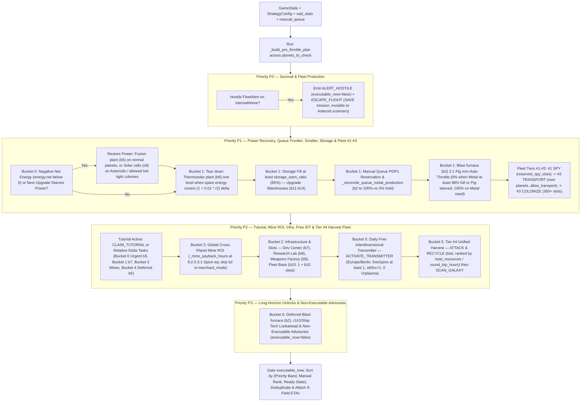
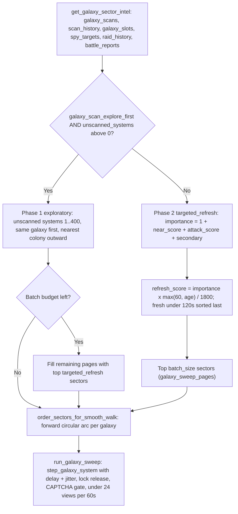

# Heuristic (`priority`) Strategy Planner Specification

Authoritative specification for the deterministic **Heuristic (`priority`) Strategy Planner** implemented in [`spaceinvasion/planner/strategy.py`](../spaceinvasion/planner/strategy.py), paired with combat/colony helpers in [`spaceinvasion/combat/fleet.py`](../spaceinvasion/combat/fleet.py), ETA/ranking calculations in [`spaceinvasion/combat/ranking.py`](../spaceinvasion/combat/ranking.py), state/eligibility models in [`spaceinvasion/core/state.py`](../spaceinvasion/core/state.py), and runtime configuration in [`spaceinvasion/core/config.py`](../spaceinvasion/core/config.py).

> [!IMPORTANT]
> The Heuristic (`priority`) planner is the default autonomous decision engine (`StrategyConfig.planner_mode = "priority"`) and also serves as the deterministic seed chromosome and safety guardrail baseline when running the evolutionary `ga_nn` optimizer (`spaceinvasion/planner/optimizer.py`).

---

## 1. Overview & Execution Model

### 1.1 Deterministic `P0` -> `P1` -> `P2` -> `P3` Pipeline (`plan_actions`)

Every planning cycle (`plan_actions` in `spaceinvasion/planner/strategy.py` plus operator queue merging in `GameApiBridge._plan_with_summary`) evaluates an immutable `GameState` snapshot and `StrategyConfig` through a strictly deterministic, side-effect-free pipeline:

1. **State & Intelligence Enrichment**:
   - Attaches persisted `raid_stats` (`history`, `blocked_targets`, `bash_blocks`), daily `transmitter_status`, `scanned_systems` timestamps, `throttle_cooldowns`, and (when `allocated_normal_planets < max_planets`) unprobed/graded free `colony_candidates`.
2. **Pre-Throttle Plan Construction (`_build_pre_throttle_plan`)**:
   - **`P0` Survival Pass**: Inspects `state.fleet_alerts` on the active colony and emits `ALERT_HOSTILE` + `ESCAPE_FLIGHT` (`SAVE` mission) whenever a hostile inbound fleet is detected.
   - **Per-Planet `P1` Safety Pass**: Iterates across `planets_to_check` to emit negative-energy recovery (`energy.net < 0`), `Thermosolar plant` (`b6`) planetary field reclamation (`DEMOLISH_BUILDING`), and `>= 85%` warehouse overflow protection (`b11`–`b14`).
   - **`P2` Tutorial vs. Economy Pass**:
     - If `state.tutorial.can_complete` is `True`, emits `CLAIM_TUTORIAL` (`P2`) and holds further expansion until the reward is collected.
     - Otherwise, runs the relative-delta Tutorial solver (`_plan_tutorial_actions`); once tutorial building/research tasks are clear, evaluates `_plan_economy_for_planet` and `_plan_unlock_and_advisory_actions` across all eligible colonies, promoting proactive power (`P1`) if the best mine would starve energy and sorting mine upgrades **globally across all colonies** by shortest Spice-equivalent payback hours.
     - Appends tutorial fleet/ship milestones (`_plan_tutorial_fleet_milestones`), storage-cap unlock warehouses (when a `P1`/`P2` `WAIT_RESOURCES` upgrade costs more than current warehouse capacity), and autonomous fleet/recon dispatches (`_plan_combat_and_raid_actions`).
3. **Daily Free Transmitter Injection (`_plan_transmitter_action`)**:
   - Appends `ACTIVATE_TRANSMITTER` (`P2`) when due in `Europe/Berlin` server time and `allow_transmitter=true`.
4. **Smelter Bottleneck & Storage-Full Auto-Throttling (`_plan_blast_furnace_throttle`)**:
   - Evaluates `Blast furnace` (`b2`) `0%` / `100%` slider transitions against the assembled plan, running a 1-step forward bounce simulation (`_check_bounce=True`) so throttling never oscillates on the next tick.
5. **Strict Priority Sort & Deduplication**:
   - Orders actions by `(priority_rank[a.priority], 0 if a.executable_now else 1)` where `P0 < P1 < P2 < P3`, placing immediately executable actions ahead of waiting/blocked actions within each band, and deduplicates by `(kind, planet_id, target_id, target_name)`.
6. **Fleet-Slot Cooldowns & Manual Queue Merge (`merge_manual_queue_actions`)**:
   - Applies colony fleet-slot cooldowns (`1 + b10` concurrent flights), merges pending `manual_queue` commands with `P0`/`P1` resource reservation, reconciles queue-position Metal production (`_reconcile_queue_metal_production`), and attaches 9-field ETAs (`attach_action_etas`).

### 1.2 Multi-Planet Evaluation (`allow_multi_planet`)

- **`allow_multi_planet = true` (Default)**:
  - Evaluates all owned planets (`planets_to_check`), sorting `state.active_planet()` first (`0` vs `1`) for deterministic tie-breaking.
  - Enables **parallel remote colony upgrades** (`allow_remote_colony_build = True` on non-active colonies): when `building_offers` DOM cards are missing, behind live building levels, or stale-cached with a resource-only shortage (`_is_stale_remote_resource_wait` in `strategy.py`/`optimizer.py` and `_find_build_action` in `api_server.py`), the planner verifies planet-type eligibility, free building fields, `game_data.missing_prerequisites`, and `planet.resources.can_afford(cost)` so `commander.py` switches to the remote colony and builds in parallel with the active planet (while genuine non-resource blocks like `"Building in progress"`, `"Queue full"`, or unmet prerequisites remain blocked, and `P0`/`P1` manual queue reservations remain strictly scoped per planet).
  - Pools `(payback_hours, PlannedAction)` tuples across every non-raid planet and ranks them in a single global list so resources are invested on the highest-ROI colony first.
- **`allow_multi_planet = false`**:
  - Restricts `planets_to_check` strictly to `[state.active_planet()]` and disables remote cross-colony build/scan fallbacks.

### 1.3 Planet-Type Invariants (`normal`, `asteroid`, `raid`)

Planet classification is normalized via `normalize_planet_type` and enforced by `is_building_allowed_on_planet_type` (`spaceinvasion/core/state.py`):

| Planet Type | Build Queue Slots (`_max_build_slots`) | Permitted Buildings & Power Rules | Operational & Cap Invariants |
|---|---|---|---|
| **`normal`** (Standard Colony / Homeworld) | **5** slots (**6** when `specs["construction_commander"] > 0`) | `b1`–`b18`, `b20`–`b21` (`b19` *Galaxy scanner* forbidden). Powered by `Fusion plant` (`b5`), plus `b6`/`s9` only when `forbid_planetary_solar=false`. | Counts toward `allocated_normal_planets < max_planets` (default `11`). Starter homeworld (`230` fields) cannot be abandoned; legacy `b6` can be demolished (`DEMOLISH_BUILDING`). |
| **`asteroid`** (Orbital Asteroid) | **1** slot (`_max_build_slots == 1`) | **Solar-only power** (`Solar cells` `s9`, `0` fields). Permits only `asteroid_ok=True` buildings (`b7` *Dev center*, `b9` *Weapons factory*, `b10` *Fleet base*, `b17` *Microsystem*, `b19` *Galaxy scanner*), plus `b8` *Research lab* **only** via Synth node (`has_b8_offer=True`). | **No mines** (`b1`–`b4`), **no planetary power** (`b5`, `b6`), **no warehouses** (`b11`–`b14`), **no `b6` demolition**, and **no `b2` throttling**. Excluded from `max_planets`. |
| **`raid`** (`[RK]` Raid Colony) | Isolated staging colony | Forbids `RAID_COLONY_FORBIDDEN_BUILDINGS = {1, 2, 3, 4, 5, 6, 8, 11, 12, 13, 14, 19, 20, 21}`. | **Strict `[RK]` Isolation**: Completely excluded from mine ROI, energy recovery, warehouse guards, `b2` throttling, `b6` demolition, `RESEARCH`, `BUILD_SHIP`, and automated fleet/sweep origin selection. Excluded from `max_planets`. |

### 1.4 Nine-Field ETA Attachment (`compute_action_eta`)

Every `PlannedAction` emitted by `plan_actions` or `merge_manual_queue_actions` is annotated by `attach_action_etas` / `compute_action_eta` (`spaceinvasion/combat/ranking.py`) using the target colony's live net hourly production (`estimate_planet_hourly_economy`, accounting for universe `speedup_factor`, proportional energy throttling `prod_ratio = min(1.0, produced / used)`, `Mining technology` `r1`, slider percentages `resource1..4`, and `2:1` `Blast furnace` Pig iron burn):

| # | Field | Type | Computation & Semantics |
|---|---|---|---|
| 1 | `wait_hours` | `float \| None` | Hours required to accumulate `missing` resources (`max(missing[r] / net_rate_hr[r])`; `0.0` when `missing == 0`; `None` if any missing resource has `net_rate_hr <= 0`). |
| 2 | `wait_seconds` | `float \| None` | `wait_hours * 3600.0` (`0.0` when ready; `None` when stalled). |
| 3 | `wait_eta` | `str` | Compact wait string (`"Ready"`, `"12m"`, `"3.4h"`, `"2.1d"`, or `"—"`). |
| 4 | `duration_seconds` | `float` | In-game execution/build duration (`0.0` for instant/dispatch kinds `ALERT_HOSTILE`, `ESCAPE_FLIGHT`, `CLAIM_TUTORIAL`, `THROTTLE_BUILDING`, `SCAN_GALAXY`, `SPY`, `COLONIZE`, `ATTACK`, `RECYCLE`, `TUTORIAL_TASK`; `base_time_s / ((b7 + 1) * 2^b17 * speedup)` for `BUILD` / `WAIT_RESOURCES` / `DEMOLISH_BUILDING`; `base_time_s / ((b8 + 1) * speedup)` for `RESEARCH` [unboosted by `b17`]; `(qty * base_build_time_s) / (max(1, b9) * 2^b17 * speedup)` for `BUILD_SHIP`). |
| 5 | `duration_text` | `str` | Human-readable duration (`"Instant"`, `"1s"`, `"5m 30s"`, `"2h 15m"`). |
| 6 | `total_hours` | `float \| None` | End-to-end completion horizon `(wait_seconds + duration_seconds) / 3600.0`. |
| 7 | `total_seconds` | `float \| None` | `wait_seconds + duration_seconds`. |
| 8 | `total_eta` | `str` | Total completion label (`"Ready"`, `"18m"`, `"4.0h"`, or `"—"`). |
| 9 | `eta_bottleneck` | `str \| None` | Limiting resource key with the longest `wait_hours` (`"pig_iron"`, `"metal"`, `"kryptonite"`, `"spice"`, or `None` when affordable). |

---

## 2. Priority Tiers (`P0`–`P3`) & Internal Decision Buckets (`0`–`6`)

### 2.1 Priority Tier & Decision Bucket Matrix

Within each priority band (`P0` -> `P3`), actions are ordered by internal decision buckets (`0`–`6`) before final `executable_now` gating. When a colony's construction queue is full (`queued_buildings >= _max_build_slots`), `_apply_queue_cap_if_full` converts an otherwise ready `BUILD` into `kind="WAIT_RESOURCES"` with `executable_now=False` and appends `"(build queue full)"`.

| Tier | Bucket | Domain & Action Kinds | Ordering & `executable_now` Gate |
|---|---|---|---|
| **`P0`** | **Bucket `0`** (Survival) | `ALERT_HOSTILE`, `ESCAPE_FLIGHT` (`SAVE`) | Sorts ahead of all manual and heuristic items (`sort_key = -1`). `ALERT_HOSTILE` keeps `executable_now=False`; `ESCAPE_FLIGHT` requires feasible cargo/ships, fuel Spice, and `allow_fleetsave=true`. |
| **`P1`** | **Bucket `0`** (Emergency & Proactive Power) | `BUILD` (`b5`/`b6`), `BUILD_SHIP` (`s9`), `WAIT_RESOURCES` | Triggered when `energy.net < 0` or when the top-ROI `P2` mine / paused `Blast furnace` would push `projected_net < 0`. Requires free fields (for `b5`/`b6`), `can_afford`, and free build slot. |
| **`P1`** | **Bucket `1`** (Queue Frontier, Solar Tear-Down, Smelter, Storage & Priority Fleet `#1–#3`) | Manual `P0`/`P1` queue, `DEMOLISH_BUILDING` (`b6`), `THROTTLE_BUILDING` (`b2`), `BUILD` (`b11`–`b14`), **`SPY` (`#1`)**, **`TRANSPORT` (`#2`)**, **`COLONIZE` (`#3`)** | Manual queue items sort at `(p_band, 0, manual_sort_rank)`. Auto `b2 -> 0%` triggers immediately when Metal storage `>= 98%` full or Pig iron is bottlenecked; `b6` demolishes when spare energy covers `(1 + 0.01 * r2)` loss; warehouses trigger at `>= storage_warn_ratio` (`85%`). Fleet dispatches enforce strict **4-tier priority**: `#1 SPY` (free colony-slot probes + player/`Spacia` recon, protected by `reserved_spy_slots`), `#2 TRANSPORT` (own-planet shortfall & young-colony supply, gated by `allow_transport`), and `#3 COLONIZE` (parallel `s8` dispatch on probed `300+`-field slots). |
| **`P2`** | **Bucket `1`–`2`** (Tutorial Claim, Fast-Build Infra & Facility Unlocks) | `CLAIM_TUTORIAL`, `BUILD` (`b7`, `b8`, `b9`, saturated `b10`), leaf prereqs | `CLAIM_TUTORIAL` fires immediately when `tutorial.can_complete=true`. In tutorial & unlock flows, `Development center` (`b7`, Bucket `1`) precedes facility unlocks (`b8`, `b9`, `b10`, Bucket `2`). |
| **`P2`** | **Bucket `3`** (Primary Mines & Tutorial Resource Tasks) | `BUILD` / `WAIT_RESOURCES` (`b1`, `b2`, `b3`, `b4`), tutorial `RESEARCH` | Ranked globally across non-raid colonies by lowest `_mine_payback_hours` at `6 : 2.5 : 3 : 1` Spice-equivalent parity (`b2` skipped in `merchant_mode` or deferred when Pig-capped). |
| **`P2`** | **Bucket `4`** (Deferred Non-Urgent Tutorial Power) | `BUILD` / `WAIT_RESOURCES` (`Fusion plant` `b5`) | **Tutorial Energy Invariant**: Non-urgent `Fusion plant` (`b5`) tasks are placed in `bucket = 4` (after Bucket `3` mines) whenever `projected_net > 0` and upcoming tutorial tasks do not starve energy. |
| **`P2`** | **Bucket `5`** (Daily Transmitter, Shipyard & Tier `#4` Unified Harvest Fleet) | `ACTIVATE_TRANSMITTER`, `BUILD_SHIP`, **`ATTACK` & `RECYCLE` (tied `#4`)**, `SCAN_GALAXY`, `THROTTLE_BUILDING` (`P2`) | Free daily `ACTIVATE_TRANSMITTER` (`allow_transmitter`), `shipyard_targets` batches (`allow_shipyard`), and unified Tier `#4` harvest pool merging **`ATTACK`** and **`RECYCLE`** at identical priority sorted strictly by **expected resource per flight time** (`total_resources / round_trip_flight_hours`, annotated with `RT · res/h`), followed by `SCAN_GALAXY`. |
| **`P3`** | **Bucket `6`** (Advisories & Tech-Tree Lookahead) | Deferred `b2`, `RESEARCH` (`r1`/`r2`/prereqs), `b10` headroom, `SHIP`, `TUTORIAL_TASK` | Long-horizon `r1`/`r2` & ship-unlock chain steps; non-building advisories without live DOM controls (`SHIP`, `TUTORIAL_TASK`, unindexed `RESEARCH`) strictly enforce `executable_now=False`. |

### 2.2 Decision Pipeline Flowchart

---

## 3. `P0` Survival & Power Recovery Rules

### 3.1 Inbound Hostile Fleet Detection & `ESCAPE_FLIGHT` (`SAVE`)

Whenever `internalHome` reports a `FleetAlert` with `hostile=True` on the active colony:

1. **Warning Banner (`ALERT_HOSTILE`)**:
   - Emits a `P0` `ALERT_HOSTILE` record (`executable_now=False`) containing `alert.summary` so the Operator Console and logs highlight the incoming attack immediately.
2. **Escape Flight Packing (`plan_escape_flight` in `spaceinvasion/combat/fleet.py`)**:
   - Selects all stationed mobile ships (`s1`–`s8`, `s10`–`s16`), explicitly **excluding stationary orbital `Solar cells` (`s9`)** unless `save_solar_cells=True`.
   - Computes total fleet cargo capacity (`fleet_cargo_capacity`, including the `+5%/lvl` Miner specialization bonus).
   - **Fuel Reserve (`fleet_save_fuel_reserve_spice`, default `500`)**: Holds back `fleet_save_fuel_reserve_spice` units of Spice on the planet (and inside cargo headroom) so the fleet can pay launch propellant; aborts as infeasible if on-planet Spice is below `min(fuel_reserve, 50)` or mobile cargo capacity is `0`.
   - **Cargo Value-Density Priority**: Prioritizes rare high-value resources ahead of bulk raw iron (`Spice` first, followed by refined/high-tier `Kryptonite` & `Metal` at `6 : 2.5 : 3 : 1` Merchant Spice-equivalent density — `Spice [1.00 SpEq] -> Metal [0.40 SpEq] -> Kryptonite [0.33 SpEq] -> Pig iron [0.17 SpEq]` — so bulk `Pig iron` never crowds out scarce `Spice`, `Kryptonite`, or `Metal`).
   - **SpaceInvasion Classic `SAVE` Invariants**:
     - Dispatches on the `SAVE` (*Escape flight*) mission toward a sister colony coordinate (or own coordinate fallback).
     - **100% invisible to Asteroid *Galaxy scanners* (`b19`)**, and fleets in flight cannot be intercepted until they touch down.
     - Gated by `executable_now = cfg.allow_fleetsave`.

### 3.2 Negative Net Energy (`energy.net < 0`) Emergency Restoration

In SpaceInvasion Classic, planetary energy is instantaneous (never stored). Whenever `energy.produced < energy.used` (`energy.net < 0`), **every mine and smelter on that colony throttles proportionally** (`prod_ratio = produced / used`). Emergency restoration runs at the top of the per-planet safety pass before any `P2` economy upgrades:

- **Normal Planets (`planet_type == "normal"`)**:
  - **`forbid_planetary_solar = true` (Recommended Field-Preservation Policy)**: Strictly selects `Fusion plant` (`b5`, fuel-free planetary power) and forbids both `Solar cells` (`s9`) and `Thermosolar plant` (`b6`).
  - **`forbid_planetary_solar = false`**:
    - Uses `Solar cells` (`s9`, `BUILD_SHIP`, `0` building fields) when `Weapons factory` (`b9 >= 1`) and `allow_shipyard=true` are available **and** either the planet has `0` free building fields (`fields_used >= fields_max`) or qualifies as a **hot tight-field colony** (`0 < fields_remaining <= min_free_fields_warning` [default `20`] and `temperature >= hot_planet_solar_temp_threshold` [default `40 °C`]).
    - Otherwise calls `_pick_best_power_building`: defaults to `Fusion plant` (`b5`), selecting `Thermosolar plant` (`b6`, capped at `L6`) only on spacious (`fields_remaining > 40`) deep-cold (`temperature <= -100 °C`, `Spice mine >= 12`) colonies where `b6` Spice consumption is `<= 50%` of local Spice mine output and `thermo_cpe < 0.70 * fusion_cpe`.
- **Asteroids (`planet_type == "asteroid"`)**:
  - Planetary power buildings (`b5`, `b6`) are forbidden on Asteroids. Restores negative energy exclusively by building orbital `Solar cells` (`s9`, `0` fields) when `Weapons factory` (`b9 >= 1`) is built and `allow_shipyard=true`.

---

## 4. `P1` Queue Frontier, Bottleneck Throttling & Storage Protection Rules

### 4.1 Manual Command Queue (`manual_queue`) Reservation & Metal Frontier Reconciliation

Operators can pin `BUILD`, `DEMOLISH_BUILDING`, `RESEARCH`, `BUILD_SHIP`, `THROTTLE_BUILDING`, `SPY`, `ATTACK`, `RECYCLE`, `COLONIZE`, `SCAN_GALAXY`, `CLAIM_TUTORIAL`, and `ACTIVATE_TRANSMITTER` entries in SQLite (`manual_queue`) at priorities `P0`–`P3`. `merge_manual_queue_actions` enforces three invariants:

1. **Auto-Satisfaction & Deduplication**:
   - Automatically completes pending queue items whose target state is already achieved (`planet.building_level(bid) >= goal_lvl`, `state.researches[rkey] >= goal_lvl`, `cur_lvl <= raw_goal` for demolition, or `economy_rates["resource{bid}"] == pct` for throttling) and suppresses duplicate heuristic actions matching `(norm_kind, planet_id, target_id, norm_coords)`.
2. **`P0` / `P1` Resource Reservation**:
   - Pending `P0` and `P1` manual `BUILD`, `RESEARCH`, and `BUILD_SHIP` items with met prerequisites accumulate their full resource cost into `reserved_by_pid[planet_id]`.
   - Any lower-priority heuristic action (`act_prio > reserved_prio`) on the same colony that shares at least one non-zero resource type with `reserved_by_pid` and would push combined spend beyond `planet.resources` is held at `executable_now=False` with `"[Saving resources for prioritized user queue]"`.
3. **Queue-Position Metal Production Review (`_reconcile_queue_metal_production`)**:
   - Walks each colony's merged resource-consuming actions (`BUILD`, `WAIT_RESOURCES`, `RESEARCH`, `BUILD_SHIP` with met prerequisites) in exact execution order, tracking remaining `avail_pig` and `avail_met` to locate the earliest manual item missing Metal (`first_metal_idx`):
   - **Frontier Needs Metal (No Earlier Pig-Iron Blocker)**: Cancels any auto `Blast furnace -> 0%` pause on that colony and, if Metal storage is `< 98%` full and `b2` is running below `100%`, inserts an immediate `THROTTLE_BUILDING` (`Blast furnace -> 100%`, or highest sustainable `90%..10%` step consuming `<= 85%` of gross Pig iron output when the item also lacks Pig iron) directly ahead of the pinned item.
   - **Earlier Item Pig-Iron Starved (`earlier_pig_blocker`)**: If an earlier queued item lacks Pig iron (`need_pig > 0`, `need_met == 0`, within Pig iron storage capacity), strips any auto `b2 > 0%` resume, inserts `THROTTLE_BUILDING` (`Blast furnace -> 0%`) ahead of the Pig-iron-starved item when `cur_b2_pct > 0`, and annotates the later Metal item with `"[Metal production queued after <item> Pig iron completes]"`.

### 4.2 `Blast furnace` (`b2`) `2:1` Pig Iron Auto-Throttling

In SpaceInvasion Classic, `Blast furnace` (`b2`) converts **2 Pig iron into 1 Metal** (`pig_iron_used = 2 * prod`) and is **never boosted by `Mining technology` (`r1`)**. When `auto_throttle_blast_furnace=true` and `merchant_mode=false`, `_plan_blast_furnace_throttle` manages `internalEconomy` (`resource2`) on normal colonies:

- **Upgrade Cap (`blast_pig_iron_max_share = 0.70`)**: In `_plan_economy_for_planet`, upgrading `b2` to `L+1` is deferred to `P3` whenever `blast_furnace_pig_iron_used(L + 1) > pig_prod * blast_pig_iron_max_share` (or while `b2` is paused at `0%` with zero Metal build cost).
- **Immediate `0%` Storage-Full Guard (`P1`, Cooldown-Exempt)**:
  - Whenever **Metal storage is `>= 98%` full** (`res_met * 100 >= sto_met * 98`) while **Pig iron storage still has free capacity** (`< 99%`), immediately emits `P1` `THROTTLE_BUILDING` (`Blast furnace 0%`), bypassing the `300s` throttle cooldown so `2:1` Pig iron is never destroyed in overflowed Metal smelting.
- **Pig-Iron Bottleneck Pause (`0%`)**:
  - Emits `P1` `Blast furnace 0%` when the top `WAIT_RESOURCES` blocker needs Pig iron only (`missing.pig_iron > 0` and `missing.metal == 0`, within storage cap) and no positive-Pig Metal starvation overrides it, or when no planned item needs Metal and `net_pig_at_100 < 0` with `res_pig < max(500, 0.5 * bf_pig_used_full)`.
  - Emits `P2` `Blast furnace 0%` when no planned item needs Metal and either Metal fill `>= storage_warn_ratio` or `net_pig_at_100 < 0` with `res_pig < bf_pig_used_full`.
- **Hysteresis & Energy-Safe Resume (`100%`)**:
  - Resumes `b2 -> 100%` only when Metal fill `< 0.85 * storage_warn_ratio`, no `P1` item is missing Pig iron, resuming leaves `energy.net >= 0` without triggering an unaffordable `P1` power deficit, and either Metal is needed (`P1`: `net_pig_at_100 >= 0` or `res_pig >= max(2000, 0.6 * bf_pig_used_full)`) or Pig iron reserves are abundant (`P2`: `net_pig_at_100 >= 0`, `res_pig >= max(5000, 1.5 * bf_pig_used_full)`, and `res_pig >= 2 * res_met`).
  - Enforces a **`300s` per-colony cooldown** (`throttle_cooldowns`, bypassed only when `energy.net < 0` or Metal `>= 98%` full with Pig space) plus a **1-step forward bounce check** (`_check_bounce=True`).

### 4.3 Warehouse Overflow & Cost-Cap Protection (`b11`–`b14`)

Planet storage starts at `100,000` per resource (`L0`) and doubles each level (`100,000 * 2^L` across `Pig iron warehouse` `b11`, `Metal warehouse` `b12`, `Kryptonite warehouse` `b13`, and `Spice warehouse` `b14`). Reaching `100%` capacity slashes that mine's output to **5%**.

1. **Proactive `85%` Overflow Guard (`P1`)**: On every `normal` planet, any resource whose `storage_fill_ratios()[rk] >= storage_warn_ratio` (default `0.85`) emits a `P1` warehouse upgrade (`b11`–`b14`).
2. **Upgrade Cost-Cap Guard (`P1` / `P2`)**: Whenever a planned `P1` or `P2` `WAIT_RESOURCES` build on a `normal` planet requires `cost[rk] > planet.storage[rk]`, the planner automatically schedules the matching warehouse (`b11`–`b14`) at the same priority tier so the colony never deadlocks waiting for resources it cannot store.

### 4.4 Planetary Solar Demolition (`forbid_planetary_solar` & `DEMOLISH_BUILDING`)

To preserve scarce planetary building fields for late-game mines and infrastructure, `_build_pre_throttle_plan` reclaims `Thermosolar plant` (`b6`) fields on `normal` planets one level at a time (`L -> L - 1`) whenever `cur_b6 > 0` (skipped on Asteroids, Raid colonies, during active `b6` tutorial tasks, when `b6` is already in the active build queue, or when `forbid_planetary_solar=false` on a qualifying `<= -100 °C` deep-cold Spice colony with `b6 <= 6`):

1. **Energy-Tech Adjusted Loss**: Computes the exact energy drop of tearing down `b6` level `L`, including the global `+1%/lvl` `Energy technology` (`r2`) multiplier:
   $$\Delta E_{\text{safe\_loss}} = \left\lceil \max\bigl(0,\; \Delta E_{b6}(L)\bigr) \times \bigl(1.0 + 0.01 \times \min(r_2, 200)\bigr) \right\rceil$$
2. **Throttled-Mine Reserve**: Subtracts `throttled_reserve` (the latent energy of any `b1`–`b4` mines/furnaces currently throttled below `100%`) from `min(planet.energy.net, projected_net)`.
3. **Tear-Down vs. Fusion Pre-Upgrade**:
   - If `avail_e_buffer - safe_b6_loss >= 0`, emits `P1` `DEMOLISH_BUILDING` (`Thermosolar plant`, `target_level = cur_b6 - 1`).
   - Otherwise, emits `P1` `BUILD` (`Fusion plant` `b5`) first so tearing down `b6` never causes negative energy.

### 4.5 `P1` Colony Expansion Frontier & Undersized Colony Auto-Deletion (`ABANDON_COLONY` + `COLONIZE`)

Whenever `effective_allocated_normal < max_planets` (default `11`) and `allow_colonize=true` (or an active colonization tutorial task is pending), **Colony Expansion tasks always sit at the very top of `P1` (`_band_subrank == (0, 0..5)`)**, strictly ahead of routine `P1` warehouse/demolition/throttle maintenance and all `P2` economy/raid actions in both `priority` and `ga_nn` modes:

1. **`ABANDON_COLONY` (`< min_colony_fields` Fresh-Roll Auto-Deletion, Top of `P1`)**:
   - Because SpaceInvasion RETRO free slots roll fields stochastically from a range (`planet.colonize = [minFields, maxFields, bonus]`, e.g. `140–340` fields), a newly settled colony that rolls `< min_colony_fields` (default **`300`** fields) is immediately queued for deletion via `action=internalSettings` (`confirmPlanetDeletion('<coords>', <pid>)` -> `#delete-confirm [onclick*="executeDeletePlanet"]`, `POST /command {"command": "abandon_colony", "planet_id": <pid>}`).
   - **Multi-Layer Homeworld & Developed-Colony Safety Invariant (`is_undersized_fresh_colony`)**: `ABANDON_COLONY` is strictly forbidden unless **all** of the following hold simultaneously:
     1. `planet_type == "normal"` and `len(normal_planets) >= 2` (`planet_id != homeworld_planet_id(state)`, never `Pos. 1` on `internalSettings`).
     2. `0 < fields_max < min_colony_fields` (`300`).
     3. **Zero development & zero stationed fleet/defenses**: `fields_used == 0`, `sum(buildings) == 0`, `sum(ships except s9) == 0`, `sum(defense) == 0`, and zero active construction jobs.
     4. All building/shipyard planning on `undersized_pids` is suppressed so no building is ever started on an undersized roll prior to deletion.
2. **`COLONIZE` (`s8` *Colony ship* — Parallel Dispatch, Fleet Priority #2)**:
   - **Targets**: Each `COLONIZE` goes to a different highest-graded, non-discarded candidate meeting `>= min_colony_fields`, either an exact `uninhabited_fields >= 300` or a RETRO 2D Galaxy `colonize_max_fields >= 300` in prime `Pos 7–12`. Coordinates that already have an outbound `COLONIZE` flight (`extract_in_flight_colonize_coords`) are skipped.
   - **Parallel colonization**: Let `open_planet_slots = max(0, max_planets - effective_allocated_normal - len(in_flight_colonize_coords))`. The planner emits up to `min(open_planet_slots, max(1, total_stationed_s8))` distinct `COLONIZE` actions (in `strategy.py` `_plan_combat_and_raid_actions` and `optimizer.py` `_materialize_planned_actions`). Each is assigned to a colony with a stationed `s8` and tagged `[Parallel colony k/n]`. `in_flight_colonize + new_dispatches` never exceeds the open planet slots. With `open_planet_slots == 0`, no `COLONIZE` is emitted.
   - **Strict fleet-slot priority `SPY` (#1) -> `COLONIZE` (#2) -> `ATTACK` / `RECYCLE` (#3)**, with `max_fleet_slots = 1 + b10`:
     - **`SPY` #1**: `reserved_spy_slots` (`spy_res`) also holds back `COLONIZE`. The `k`-th `COLONIZE` dispatched in a tick is held with `"Fleet slot reserved for Spy probes"` once `used_slots + k >= max_fleet_slots - spy_res`. Raid `SPY` is never held for colonization.
     - **`COLONIZE` #2**: `col_res = min(#COLONIZE on planet, open_planet_slots, s8 on planet, max_fleet_slots - spy_res)` seats are reserved against `ATTACK` / `RECYCLE`. Those missions are held with `"reserved for Colony ship"` while `used_slots >= max_fleet_slots - spy_res - col_res`.
     - **`ATTACK` / `RECYCLE` #3**: Use only the remaining seats.
3. **`BUILD_SHIP Colony ship` (`s8`) Auto-Build, Free-Slot Colony `SPY`, and Colony `SCAN_GALAXY` (`P1`)**:
   - **Proactive `s8` build for parallel colonization**: Emits `P1` `BUILD_SHIP Colony ship` (`10k Pig, 20k Metal, 10k Krypt, 5k Spice`, treated as a top Metal consumer by `_plan_blast_furnace_throttle`) while `stationed_s8 + queued_s8 + in_flight_colonize < min(open_planet_slots, max(1, max_fleet_slots - spy_res))`. The shipyard builds enough `s8` hulls to fill parallel slots, but never more than the open planet slots.
   - While `qualified_candidates_count < needed_colonies`, free-slot `SPY` probes (`1x s10`, `02:380:08 (Free slot)`) and spiral `SCAN_GALAXY` colony discovery also run at **`P1`**.
   - **`P1` sub-order**: `ABANDON_COLONY` -> free-slot `SPY` -> parallel `COLONIZE` -> `BUILD_SHIP s8` -> designated-colony `s10` probe build -> colony `SCAN_GALAXY` -> routine `P1` maintenance. Raid `SPY` stays in the `P2` band, because `commander.py` re-sorts by band; its seat is protected by `reserved_spy_slots` instead.
4. **Tried Planets Ledger (`colony_attempts`, SQLite `V011`, Append-Only)**:
   - Every colonization trial is appended to `colony_attempts` (`GameDatabase.record_colony_attempt`; read with `get_colony_attempts(limit=100)` newest first and `get_colony_attempts_summary()`). This table is insert-only (no `DELETE FROM` / `DROP TABLE`) and indexed on `(target_coords, ts)`.
   - **`event_type` values** (recorded by `GameApiBridge` in `spaceinvasion/runtime/api_server.py`):

     | `event_type` | Recorded When | Key Fields |
     |---|---|---|
     | `dispatched` | `COLONIZE` executed (API command, planner, or `commander.py` path via `_execute_and_summarize`) | `target_coords`, `origin_coords`, `min_fields_target`, plus the candidate's `expected_min_fields` / `expected_max_fields` (`colonize_max_fields` or `uninhabited_fields`), `temperature`, `grade`, `score` |
     | `failed` | Live `COLONIZE` not executed (skips non-executable / `"Guarded:"` results; repeats of the same coords + message within `600s` are deduped) | `target_coords`, `status_message` |
     | `deleted_undersized` | `ABANDON_COLONY` executed | `planet_id`, `target_coords`, `fields_rolled = fields_max`, `min_fields_target`, `temperature` |
     | `kept` / `settled` | `_record_state` sees a new secondary `normal` planet: `kept` when `fields_max >= min_colony_fields`, otherwise `settled` (still pending if `fields_max == 0`) | `planet_id`, `target_coords`, `fields_rolled`; deduped per `(planet_id, coords)` and hydrated at startup from `get_colony_attempts(limit=500)` |

   - **Summary**: `{total_events, unique_coords_tried, dispatched_count, deleted_undersized_count, kept_count, failed_count, by_coords}`, where `by_coords` is keyed by normalized `GG:SSS:PP` (`attempts_count`, `deleted_count`, `last_event_type`, `last_fields_rolled`, `last_ts`, ...).
   - **Operator Console**: `POST /command {"command": "colony_candidates"}` returns `colony_attempts`, `colony_attempts_summary`, and `attempts_by_coords`. `#view-colonies` shows them as the stacked **Tried Planets & Colonization Attempts** table (`#colonies-attempts-tbody`, with `DELETED <300` / `KEPT ≥300` / `DISPATCHED` / `SETTLED` / `FAILED` outcome pills), a `Tried / Deleted (<300)` KPI card (`#col-kpi-tried`), and per-candidate `Tried Nx · Last: ...` chips.

---

## 5. `P2` Tutorial, Economy ROI, Tech/Shipyard & Autonomous Fleet Dispatch Rules

### 5.1 Tutorial Relative-Delta Solver (`_plan_tutorial_actions` & `CLAIM_TUTORIAL`)

- **Reward Claim (`CLAIM_TUTORIAL`)**: When `state.tutorial.can_complete` is `True`, emits `P2` `CLAIM_TUTORIAL` (`executable_now=True`) and pauses non-survival actions until claimed.
- **Relative-Delta Progress**: Tracks `eff_progress = task.current + queued_counts[bid]` for buildings and `eff_r_progress = task.current + active_r_inc[rid]` for in-flight researches (`r1`–`r16`), walking leaf prerequisites via `_resolve_prereq_chain`.
- **`bucket = 4` Non-Urgent `Fusion plant` Deferral**:
  - Checks `need_power_first = (projected_net <= 0) or any_tutorial_task_starves_energy`.
  - Orders incomplete building tasks by `(bucket, eff_progress, bid)`:
    - `bucket = 0`: `Fusion plant` (`b5`) **only when `need_power_first` is `True`** (also injects a proactive `b5` build when an upcoming tutorial mine would push `projected_net < 0`).
    - `bucket = 1`: `Development center` (`b7`) for immediate `1 / (L + 1)` build-time reduction.
    - `bucket = 3`: Mines (`b1`–`b4`) and facility tasks (`b8`, `b9`, etc.).
    - **`bucket = 4`**: Non-urgent `Fusion plant` (`b5`) upgrades when `projected_net` remains comfortably positive — ensuring mines always upgrade before surplus power.

### 5.2 Economy Mine ROI Payback Math (`_mine_payback_hours`)

Once tutorial construction tasks are complete, `_plan_economy_for_planet` scores `b1` (*Pig iron mine*), `b2` (*Blast furnace*), `b3` (*Kryptonite mine*), and `b4` (*Spice mine*):

- **Spice-Equivalent Normalization (`4:2:2:1` Heuristic vs. `6:2.5:3:1` Merchant Parity)**:
  - While informal SpaceInvasion rules of thumb sometimes approximate resource weights at `4 : 2 : 2 : 1`, the official BitMeUp Merchant exchanges resources at **`6 Pig iron : 2.5 Metal : 3 Kryptonite : 1 Spice`** (`game_data.MERCHANT_RATES_IN_SPICE`).
  - `_mine_payback_hours` converts both next-level upgrade cost and marginal hourly production gain (`delta_prod = mine_production_per_hour(L + 1) - mine_production_per_hour(L)`) into exact Spice equivalents:
    $$\text{SpiceEq}(p, m, k, s) = \frac{p}{6.0} + \frac{m}{2.5} + \frac{k}{3.0} + s, \qquad \text{PaybackHours} = \frac{\text{SpiceEq}(\text{Cost}_{L+1})}{\Delta\text{SpiceEq/h}_{L \to L+1}}$$
- **`Spice mine` (`b4`) Cold-Planet Temperature Curve**: `mine_production_per_hour` linearly interpolates the wiki temperature table (`-120 °C` to `+120 °C`), rewarding cold outer-belt colonies (`Pos 13–16`) with substantially higher Spice/h and shorter payback times, multiplied by `1 + 0.02 * r1` across `b1`, `b3`, and `b4` (`b2` is unboosted).
- **`merchant_mode` Skipping `b2`**: When `merchant_mode=true`, `Blast furnace` (`b2`) is skipped entirely so colonies maximize raw `b1` / `b3` / `b4` extraction for `6 : 2.5 : 3 : 1` Merchant trading without `2:1` smelting loss or `b2` field/energy overhead.
- **Proactive Power Promotion (`P1`)**: If the lowest-payback mine (`scored_mines[0]`) has `_energy_starvation_delta(top_bid, top_nxt, projected_net) < 0` while current `energy.net >= 0`, the planner promotes a `P1` power upgrade (`Fusion plant` `b5` on normal planets, or `Solar cells` `s9` on Asteroids / allowed hot tight-field colonies) ahead of `P2` mines. When `b2` is temporarily paused at `0%` and any planned item needs Metal, `b2_latent_energy` is reserved so mine upgrades never block `b2` from resuming `100%`.

### 5.3 Infrastructure & Concurrent Fleet-Slot Scaling (`b7`, `b8`, `b9`, `b10`)

`_plan_unlock_and_advisory_actions` scales core facilities once baseline mines reach `base_ready` (`min(b1, b2, b3) >= 3`, or `min(b1, b3) >= 3` in `merchant_mode`):

- **`Research lab` (`b8`)**: Queued at `P2` when `base_ready` and `b8 == 0` (automatically building `Development center` `b7 -> L2` first if unmet).
- **`Weapons factory` (`b9`)**: Queued at `P2` when `min(b1, b3) >= 4`, `b8 >= 1`, and `b9 == 0` (unlocking `b7 -> L3` at `P2` and `Energy technology` `r2 -> L1` at `P3` if unmet).
- **`Development center` (`b7`)**: Scales at `P2` whenever `base_ready`, `b8 >= 1`, and `b7 < max(2, min(b1, b3) - 2)` (`1 / (b7 + 1)` build-time divisor).
- **`Fleet base` (`b10` -> `1 + b10` Concurrent Fleet Slots & Single-Leg `faData` Accounting)**:
  - SpaceInvasion Classic grants `max_fleet_slots = 1 + b10` simultaneous fleet dispatches.
  - **Deduplicated In-Flight Slot Counting**: On `internalHome`, `var faData` lists both an outbound leg (`return: false`, smaller `t`) and a scheduled return leg (`return: true`, larger `t`) for every outbound flight; `_parse_home_fadata_fleets` deduplicates flights to **1 `QueueJob(category="fleet")` per active mission** (keeping only the currently active leg with smaller `t`) and excludes local `#sp-own-fleet` shipyard construction rows (`detail` starting with `"Shipyard"` / `"Weapons factory"`) so `used_slots` never double-counts flights.
  - Once `b9 >= 1`, if `in_flight_fleets >= 1 + b10` (`slots_saturated`), immediately promotes `b10` at **`P2`** (`target_fb = max(fb + 1, in_flight_fleets + 1)`).
  - Otherwise, when mobile ships are stationed, fleets are in flight, or `playstyle == "fleeter"` with `min(b1, b3) >= 8`, scales `b10` toward `min(15, max(2, b7 // 2 + (2 if playstyle == "fleeter" else 1)))` (`P2` when `b10 < 2` or `in_flight_fleets >= max(1, b10)`, `P3` for extra buffer levels).

### 5.4 Playstyle Doctrines (`fleeter`, `hybrid`, `miner`) & Shipyard Targets

| Doctrine (`playstyle`) | Tech-Tree & Fleet Base Posture | Shipyard (`shipyard_targets`) Behavior |
|---|---|---|
| **`fleeter`** (Default) | Walks `_resolve_prereq_chain` across full combat & logistics roster (`small-transport`, `spy-probe`, `recycler`, `colony-ship`, `phoenix`, `transmitter`, `battleship`, `stealth-bomber`); adds `+2` `Fleet base` (`b10`) slot headroom (`b7 // 2 + 2`). | Builds single-unit `P2` `BUILD_SHIP` steps toward `shipyard_targets` when `allow_shipyard=true` and `b9 >= 1`, holding combat/transport ships (`s1..s7`, `s13..s16`) while own fleet is in transit. |
| **`hybrid`** | Focuses tech-tree ship lookahead on core logistics & colonization (`small-transport`, `colony-ship`) alongside global `r1` (*Mining tech*) and `r2` (*Energy tech* `L4`); scales `b10` to `b7 // 2 + 1`. | Maintains configured `shipyard_targets` utility/raiding fleet (`spy-probe`, `recycler`, `colony-ship`, transports, escorts) without over-investing early capital into deep warship tech chains. |
| **`miner`** | Prioritizes compound mine payback (`_mine_payback_hours`), cross-planet `r1` (`+2%/lvl` Pig/Kryp/Spice), `r2` (`+1%/lvl` energy), and minimal `b10` (`b7 // 2 + 1`); pairs cleanly with `merchant_mode=true` and `forbid_planetary_solar=true`. | Builds configured `shipyard_targets` cargo/utility hulls (`small-transport`, `large-transport`, `transmitter`, `colony-ship`, `spy-probe`, `recycler`); skips planetary `solar-cells` (`s9`) when `forbid_planetary_solar=true`. |

#### SpaceInvasion Universe Research Reference & Max Levels Table (`universe_research_max`)

All account-wide technologies scale cost and base duration by exact `2.0x` per level (`base * 2^(L - 1)`), divided by `(Research lab b8 + 1) * speedup_factor`. Persisted in dedicated SQLite tables **`universe_research_max`** and **`universe_research_max_history`** (`V009`), `GameDatabase.refresh_universe_research_max` / `get_universe_research_max` (`POST /command {"command": "universe_research_max", "sync": bool}` and `dashboard.universe_research_max`, with `#btn-refresh-universe-research` in `#view-config` plus `#universe-research-max-table` in `#view-ranking` and `[data-bcat="universe_research"]` in `#view-buildings`) tracks the monotonically non-decreasing `universe_max_level`, `gap_to_max` (`max(0, universe_max_level - own_level)`), and record `holder` / `holder_coords` across every technology by combining:
1. **Server-Synced Universe Records**: Parsed via `parse_universe_research_records` (`internalStatistics` / `internalToplist` / `internalUniverse`) and persisted into `universe_research_max.server_record_level` (`meta['universe_research_records']`).
2. **Archived Espionage Intelligence**: Highest observed enemy technology levels across all SQLite `spy_reports.researches_json` rows (`spied_max_level`, `holder`, `holder_coords`, `updated_ts`).
3. **Own Account State & Wiki Catalog Ceiling**: Player's current `state.researches` (`own_level`) alongside the offline SpaceInvasion Classic Wiki catalog ceiling (`catalog_max_level`, beyond which `_research_level_stats` extrapolates `2.0x` per level):

| Key | Slug | Research Name | Prerequisites | Catalog Max (`catalog_max_level`) | Strategic Effect & Planner Role |
|---|---|---|---|---|---|
| `r1` | `mining-technology` | Mining technology | `r2` L4, `b8` L2 | **L40** | `+2%/lvl` Pig iron (`b1`), Kryptonite (`b3`), and Spice (`b4`) across all planets (`b2` unboosted); scored by cross-planet Spice-eq payback. |
| `r2` | `energy-technology` | Energy technology | `b8` L1 | **L40** | `+1%/lvl` global energy output (`1 + 0.01 * r2` in `b6` tear-down buffer); unlocks `b9` (L1), `b6`/`r1`/`r9` (L4), `r11` (L6), `b17` (L10). |
| `r3` | `engine-research` | Engine research | `b8` L1 | **L35** | Core propulsion tree unlocking `Rocket engine` (`L2`), `Diffusion engine` (`L6`), and `Warp engine` (`L8`). |
| `r4` | `rocket-engine` | Rocket engine | `r3` L2 | **L40** | `+10%/lvl` base flight speed for `Small transport` (`s1`), `Small fighter` (`s4`), `Colony ship` (`s8`), and `Spy probe` (`s10`). |
| `r5` | `diffusion-engine` | Diffusion engine | `r3` L6 | **L40** | `+10%/lvl` flight speed for `Large transport` (`s2`), `Transmitter` (`s3`), `Starcruiser` (`s6`), `Phoenix` (`s7`), and `Recycler` (`s11`). |
| `r6` | `warp-engine` | Warp engine | `r3` L8, `b8` L8 | **L35** | `+10%/lvl` flight speed for capital hulls (`Battleship` `s13`, `Stealth bomber` `s14`, `Destroyer` `s15`, `Imperial starbase` `s16`); gates `r15` (L10). |
| `r7` | `spy-technology` | Spy technology | `b8` L3 | **L35** | Expands `SpyReport` intel depth (`resources` -> `fleet` -> `defense` -> `buildings` -> `researches`), counter-espionage, and `s14` concealment. |
| `r8` | `weapons-technology` | Weapons technology | `b8` L3 | **L40** | **`+10%/lvl` ship & turret attack power** in `1:1` zero-rapidfire `simulate_raid_outcome`. |
| `r9` | `shield-technology` | Shield technology | `b8` L4, `r2` L4 | **L40** | **`+10%/lvl` ship & turret shield strength** in `1:1` combat simulation; gates `r12` (L5) and shield domes. |
| `r10` | `defense-systems` | Defense systems | `b8` L5 | **L40** | **`+10%/lvl` structural hull/armor** in `1:1` combat simulation; unlocks `Phoenix` (`s7` at L5). |
| `r11` | `targeting-systems` | Targeting systems | `b8` L5, `r2` L6 | **L35** | Unlocks advanced planetary defense turrets (`Ion`, `Positron`, `Interval`, `Solar` cannons). |
| `r12` | `particle-analyzer` | Particle analyzer | `b8` L6, `r9` L5 | **L30** | Unlocks `Particle shield` (`b16` at L2), `Interval cannon` (L4), and `Particle cannon` (`b15` at L5). |
| `r13` | `graviton-technology` | Graviton technology | `b8` L2, `r2` L2 | **L35** | Unlocks `Light`/`Heavy graviton cannons` (`d8`, `d9`) and `Black hole research` (`r15` at L10). |
| `r14` | `teleportation` | Teleportation | `b8` L10 | **L30** | Unlocks instantaneous inter-colony `Teleporter` (`b18` at L6) and reduces teleport cooldown/energy draw. |
| `r15` | `black-hole-research` | Black hole research | `r6` L10, `r13` L10 | **L25** | Unlocks `Imperial starbase` (`s16` at L2) and extends Galaxy scanner jamming (`4h + 1h/lvl`). |
| `—` | `urplasma-extraction` | Urplasma-extraction | `b8` L10 | `None` (Special) | Special non-RETRO universe extraction technology tracked in `universe_research_max` with `catalog_max_level = null`. |

### 5.5 Daily Free Interdimensional Transmitter (`ACTIVATE_TRANSMITTER`)

`_plan_transmitter_action` emits one `P2` `ACTIVATE_TRANSMITTER` action per calendar day in **`Europe/Berlin`** server time (`server_day_key`) when `transmitter_status["due"] == True` and `allow_transmitter=true`. Live execution (`_execute_activate_transmitter` + `parse_transmitter_page`) enforces a **4-gate zero-Urplasma guard**:

1. **Free Spin Count**: Requires `_freeSpins >= 1` (or parsed free charges `>= 1`) on `internalTransmitter`; skips cleanly if `0`.
2. **Free Source Mode (`idtSrc == 1`)**: Verifies `<input name="idtSrc" value="1">` inside `#tm.form` (automatically switching to `idtSrc=1` first if `free_spins >= 1` and another tab is selected; blocks `idtSrc == 3` Urplasma mode).
3. **Zero-Urplasma DOM & Label Verification**: Requires `play == 1`, `autoAddSpin == False`, an explicit free button token (`"free"`, `"gratis"`, `"kostenlos"`, `"frei"`), and **zero** `.urplasma-icon-30` / `[class*="urplasma"]` elements or `"urplasma"` / `"activate for"` text in both BeautifulSoup and a pre-click Selenium JS check on `#tm.submit`.
4. **Post-Spin Audit**: Confirms `free_after < free_before` (or a new winning log entry) before marking the `Europe/Berlin` day complete in SQLite.

### 5.6 Autonomous Fleet Dispatch Priority, Inter-Planet `TRANSPORT`, Slot Reservation & Resource-Per-Time Ranking (`_plan_combat_and_raid_actions` & `optimizer.py`)

Both planners (`priority` and `ga_nn`) and `GameApiBridge._apply_fleet_slot_holds` enforce a strict **4-tier fleet usage priority** (below emergency `P0` `ESCAPE_FLIGHT`) with cascading fleet-slot reservations (`max_fleet_slots = 1 + b10`):

**`#1 SPY` (`P1`) -> `#2 TRANSPORT` between own planets (`P1`) -> `#3 COLONIZE` (`P1`) -> `#4 ATTACK` & `RECYCLE` (tied `P2`, ranked by `total_resources / round_trip_flight_hours`)**

1. **Tier `#1` — `SPY` (`P1`, `s10` *Spy probe* — Colony-Quota Probing, Origin Pinning & Slot Reservation)**:
   - **`SPY`-First Execution Order**: Ready `SPY` actions (both free colony-candidate probes and player/`Spacia` recon) run in `P1` ahead of `TRANSPORT`, `COLONIZE`, `ATTACK`, and `RECYCLE` so `commander.py` always dispatches `Spy probes` (`s10`) first on every batch tick.
   - **Configurable `SPY` Fleet-Slot Reservation (`reserved_spy_slots`, default `1`, range `0..10`)**: Whenever `cfg.reserved_spy_slots > 0` and ready `SPY` candidates exist alongside stationed `s10 > 0` on the dispatch colony, the runtime reserves `eff_res = min(cfg.reserved_spy_slots, max(0, max_fleet_slots - 1))` fleet slots exclusively for `SPY`. Once `used_slots >= max_fleet_slots - eff_res`, lower fleet tiers (`TRANSPORT`, `COLONIZE`, `ATTACK`, `RECYCLE`) are held (`executable_now = False`) while `SPY` remains executable up to `max_fleet_slots`.
   - **Designated vs. Auto `SPY` Dispatch Colony (`spy_dispatch_planet_id`, default `0`)**:
     - `0` (*Auto*): Automatically selects the active colony (or closest non-raid colony) with stationed `Spy probes` (`s10 > 0`).
     - `> 0` (*Designated Colony*): When matching a non-raid colony `p` in `state.planets`, uses `p` exclusively as the `SPY` launch origin (falling back to *Auto* only if the ID is absent from `state.planets`). If `p` currently has `0` stationed `s10`, holds `SPY` with `"[Hold: No Spy probes (s10) stationed on designated spy colony]"` and prioritizes building `s10` on `p` when `Weapons factory` (`b9 >= 1`) is unlocked.
   - **Player & `Spacia` Raid Recon**: Scouts inhabited eligible colonies (`yellow` inactives + `Spacia`, plus `light_red` active players inside AZ when `allow_pvp_in_az=true`) ordered by `(0 if (status_color == "yellow" or is_spacia) else 1, phys_dist_spy, -last_scanned_ts)` — closest physical distance from `probe_planet.coords` first. Respects `blocked_until_ts <= now_ts` and `BashTracker.can_attack` (`3/24h` active cap), scouting unspied targets or refreshing intel older than **4 hours** (`14,400s`).
   - **Free Colony-Candidate `SPY` Quota Rule (`qualified_candidates_count >= needed_colonies`)**:
     - Let `needed_colonies = max(0, cfg.max_planets - allocated_normal_planets)` and `qualified_candidates_count` equal the number of **non-discarded**, probed free colony slots confirmed to have `uninhabited_fields >= cfg.min_colony_fields` (`300+`).
     - While `allocated_normal_planets < cfg.max_planets` **and** `qualified_candidates_count < needed_colonies`, the planner schedules high-priority `SPY` probes (`1x s10`, covered by `reserved_spy_slots`) against unprobed (`uninhabited_fields is None` and `last_spied_ts <= 0`), **non-discarded**, non-blocked (`blocked_until_ts <= now_ts`) free colony slots — ordered by **Prime Mid-Orbit positions `7–12` first** and **closest physical distance**.
     - Once `qualified_candidates_count >= needed_colonies` (enough confirmed `300+`-field candidates found to max out `max_planets`) or `allocated_normal_planets >= cfg.max_planets`, automatic free-slot `SPY` probing **stops immediately**.
     - If an automatic free-slot probe is rejected by the server, a `6h` `blocked_until_ts` cooldown is recorded so the planner advances to the next candidate cleanly without raising blocking unread UI popups.
   - **Operator Candidate Discard (`discard_colony_candidate`)**: Operators can discard unwanted colony candidates from `#view-colonies` (`POST /command {"command": "discard_colony_candidate", "target_coords": "GG:SSS:PP"}`; reversible via `restore_colony_candidate`), persisted append-safe in SQLite `meta['discarded_colony_coords']` (zero `DELETE FROM`). Discarded coordinates are never spied, never colonized, and excluded from `qualified_candidates_count` (automatically triggering replacement free-slot `SPY` probes when `qualified_candidates_count` drops below `needed_colonies`).
2. **Tier `#2` — `TRANSPORT` (`P1`, Inter-Planet Resource Logistics Between Own Planets — `plan_interplanet_transports`)**:
   - **Strict Own-Planet Safety**: Strictly transfers resources between two distinct owned non-raid, non-asteroid planets (enforced independently in `plan_interplanet_transports`, `api_server.py`, and `ActionExecutor._execute_transport`). Gated by `allow_transport` (`POST /command {"command": "transport", ...}`).
   - **Demand & Cargo Packing**: Supplies concrete `P1`/`P2` building/research/shipyard resource shortfalls (`missing > 0`) and bootstraps young colonies (`fields_used <= 15` or `b1 < 8` with `< 20,000` total resources). Protects each donor's own `P0`/`P1` resource costs + `fleet_save_fuel_reserve_spice` (default `500` Spice), caps recipient deliveries at `85%` of warehouse storage, skips destinations that already have an outbound `Transport` flight in transit, selects minimal cargo hulls (`s3 -> s2 -> s1`), and ranks donors by highest `cargo_units / round_trip_flight_hours`.
   - **Slot Reservation**: Yields only to `#1 SPY` (`reserved_spy_slots`) and reserves its needed slots ahead of `#3 COLONIZE` and `#4 ATTACK`/`RECYCLE`. Live Selenium execution fills `roheisen`/`metall`/`kryptonit`/`spice` on `internalSendFleet` and aborts cleanly before clicking Launch if the cargo inputs cannot be confirmed.
3. **Tier `#3` — `COLONIZE` (`P1`, `s8` *Colony ship* — Confirmed `300+` Settlement)**:
   - Gated by `allocated_normal_planets < max_planets` (default `11` normal planets) and `allow_colonize=true` (plus stationed `s8` and no own fleet in transit during hold checks).
   - **Probed Non-Discarded Candidates Only**: Emits `COLONIZE` (`s8`) strictly on **probed, non-discarded** free slots confirmed to meet `uninhabited_fields >= min_colony_fields` (`300+` fields, graded `S` / `A+` by `grade_colony_candidate`), ranked by highest colony grade score, field count, and shortest distance.
   - **Parallel Dispatch & Slot Priority**: Up to `min(open_planet_slots, max(1, total_stationed_s8))` distinct `COLONIZE` actions per tick (`[Parallel colony k/n]`). Yields to `#1 SPY` and `#2 TRANSPORT`, and holds `col_res` fleet seats against Tier `#4` (`ATTACK` / `RECYCLE`). Every dispatch, failure, kept roll, and deleted roll is logged in `colony_attempts` (see §4.5).
4. **Tier `#4` (TIED SAME PRIORITY) — `ATTACK` & `RECYCLE` (`P2`, Unified Resource-Per-Flight-Time Pool)**:
   - **`ATTACK` and `RECYCLE` share identical priority (`P2`, Bucket `5`) and are merged into one unified harvest pool sorted strictly by expected resource throughput per round-trip flight hour**:
     $$\text{res/h} = \frac{\text{expected\_total\_resources}}{\text{round\_trip\_flight\_seconds} / 3600}$$
     where `estimate_fleet_flight_seconds` (`spaceinvasion/combat/fleet.py`) applies SpaceInvasion Classic distance units (`20,000 * Δgal` across galaxies, `1000 + 175 * Δsys` across systems, `1000 + 5 * Δpos` within a system) divided by the slowest ship's engine-boosted speed (`+10%/lvl` for `r4` Rocket, `r5` Diffusion, `r6` Warp). Both `ATTACK` and `RECYCLE` actions display `RT · ... res/h` in their reason text, and a nearby high-yield debris field will naturally rank ahead of a slower/farther raid (and vice versa).
   - **`ATTACK` (Zero-Rapidfire `1:1` Raid Simulator)**:
     - Simulated via `simulate_raid_outcome` & `score_raid_target` (`spaceinvasion/combat/fleet.py`): zero rapidfire (`1:1` targeting) with `+10%/lvl` `r8`/`r9`/`r10` scaling, `s14` *Stealth bomber* pre-round turret suppression, `power_ratio >= combat_safety_margin` (default **`1.4x`**), and `50%` cargo-capped plunder `>= raid_min_loot_spice_eq` (default **`1500.0` Spice-eq**).
     - Raids **yellow inactives** (`>7d`) and **`Spacia`** AI planets by default; includes **`light_red` active players inside AZ (`AZ ±2`) ONLY when `allow_pvp_in_az=true`**. Never targets ownerless non-Spacia coordinates. Enforces the **`3/24h` Bash cap** and **`6h` (`21,600s`) server protection / `attackzone` / mission-unavailable cooldowns** (`blocked_until_ts`). Gated by `allow_raids=true`.
   - **`RECYCLE` (`s11` *Recycler* — Debris Harvest)**:
     - Targets coordinates with `has_debris == True` when `Recycler` (`s11`) hulls are stationed on a non-raid colony. Expected harvest uses `min(recycler_cargo_capacity, known_debris_resources)` enriched from SQLite `battle_reports` / `recycle_reports` (falling back to `min(recycler_cargo_capacity, 25,000)` when galaxy intel shows debris without a prior combat/recycle report). Gated by `allow_raids` or `allow_galaxy_scan`.
5. **`SCAN_GALAXY` & Background Smart 2-Phase 2D Galaxy Sweep**:
   - **Spiral Recon (`SCAN_GALAXY`)**: Single-system recon around non-raid colonies (`R = 15` systems default; `R = 25` when colonizing or tutorial-recycling) with an **`1800s` (`30m`) per-system cooldown** (`scanned_systems`), gated by `allow_galaxy_scan`. With `galaxy_scan_explore_first=true`, never-scanned systems are picked first, walking outward from the colony. Once nearby systems are covered, stale candidates are ranked by the same proximity (`galaxy_scan_near_weight`) and frequent-attack (`galaxy_scan_attack_weight`, from `raid_stats["history"]` + `raid_targets` owner counts) scoring as the background sweep (§5.6.1), not by raw age alone. Selection goes through `optimizer.select_planner_scan_system`, shared by the live `strategy.py` `_next_spiral_scan_action` and `optimizer.py` `_next_unscanned_system`. It returns `None` when every system within the radius is on the `30m` cooldown, leaving far-galaxy exploration to the background sweep. The GA simulation keeps the legacy spiral.
   - **Background Smart Sweep (`GameApiBridge.run_galaxy_sweep`)**: Every `galaxy_sweep_interval_seconds` (default **`270s`**, `<= 5 min`), sweeps a batch of `galaxy_sweep_pages` (default **`100`**) `(galaxy, system)` sectors. The batch comes from `select_smart_galaxy_scan_batch` (§5.6.1). An explicit operator/test `start_system` override keeps the old contiguous walk. Each page is a `step_galaxy_system` (`si.navigate` XHR) step that releases `GameApiBridge._lock` between clicks, honors the `captcha_blocked` freeze gate, stays inside `< 24 views / 60s`, and sleeps `max(0.2, galaxy_scan_click_delay_seconds + random.uniform(-galaxy_scan_click_jitter_seconds, +galaxy_scan_click_jitter_seconds))` between pages (`galaxy_scan_click_delay_seconds = 1.5s`, `galaxy_scan_click_jitter_seconds = 0.6s`).

#### 5.6.1 Smart 2-Phase Galaxy Scanner (Exploratory -> Weighted Sector Refresh)

The background sweep and planner `SCAN_GALAXY` share one pure, deterministic ranking engine in [`spaceinvasion/combat/fleet.py`](../spaceinvasion/combat/fleet.py). It reads SQLite sector intelligence from [`spaceinvasion/db/storage.py`](../spaceinvasion/db/storage.py):

| Layer | Function | Role |
|---|---|---|
| SQLite (read-only) | `GameDatabase.get_galaxy_sector_intel(*, galaxies=None, now_ts=None)` | Aggregates `galaxy_scans`, `galaxy_scan_history`, `galaxy_slots`, `spy_targets`, `raid_history`, and `battle_reports` into per-`"GG:SSS"` sector metrics, per-owner attack stats (`owner_attack_counts`, `owner_raid_stats`), and coverage (`explored_systems`, `unscanned_systems`, `total_systems`, `coverage_pct`). Strictly read-only. |
| Distance | `galaxy_sector_distance(galaxy, system, own_colonies, *, systems_per_galaxy=400)` | Minimum circular system distance to any own non-raid colony, with a cross-galaxy penalty. |
| Scoring | `score_galaxy_scan_sectors(...)` | Scores every system `1..400` in each active galaxy (`phase`, `score`, `importance`, `near_score`, `attack_score`, `secondary_score`, `staleness_factor`, `reason`). |
| Batch | `select_smart_galaxy_scan_batch(..., batch_size=100, ...)` | Picks the top-`K` batch and returns `phase` / `scan_phase`, coverage counters, `exploratory_count`, `refresh_count`, `selected_sectors`, and `sample_targets`. Takes either SQLite `sector_intel` (runtime sweep) or in-memory `scanned_systems` / `raid_targets` / `raid_stats` (planner). |
| Walk order | `order_sectors_for_smooth_walk(sectors, *, primary_colony_by_galaxy=None)` | Reorders the chosen batch along a forward circular arc per galaxy, starting after the largest gap, so `step_galaxy_system` never jumps back and forth. |

**Active galaxies**: Every galaxy that holds at least one own non-raid colony. `total_systems = 400 x len(active_galaxies)` (or the number of in-radius systems when `max_radius` is set).

##### Phase 1 — `"exploratory"` (Full Galaxy Coverage First)

- **Enabled when** `galaxy_scan_explore_first = true` and `unscanned_systems > 0` (some system `1..400` in an active galaxy has `last_scanned_ts <= 0`).
- **Ordering**: Unscanned systems sort by `(same-galaxy first, distance, ring offset (system - anchor_system) mod 400)`, where the anchor is the first own colony in that galaxy. Coverage grows outward from home and stays contiguous.
- **Spare budget**: If fewer than `batch_size` unscanned systems remain, the rest of the page budget refreshes the highest-scoring already-scanned sectors (Phase 2 ranking). The exploratory and refresh slices are each smooth-walk ordered, exploratory first.
- **Exit**: Once `explored_systems == total_systems` (`coverage_pct == 100.0`), every later batch is `"targeted_refresh"`.

##### Phase 2 — `"targeted_refresh"` (Weighted Sector Refresh)

Each `(g, s)` sector gets a `refresh_score` built from proximity, attack affinity, secondary farm value, and staleness. Weights are clamped: $w_{near}, w_{atk} \in [0, 20]$.

1. **Proximity** (`galaxy_scan_near_weight`, default `2.0`):
   $$d = \min_{c \in \text{colonies}} \begin{cases} \min(|s - s_c|,\ 400 - |s - s_c|) & g = g_c \\ 250 \cdot |g - g_c| + \min(|s - s_c|,\ 400 - |s - s_c|) & g \ne g_c \end{cases}$$
   $$\text{near\_score} = 2.5 \cdot w_{near} \cdot \begin{cases} \dfrac{1}{1 + d/20} & \text{same galaxy as a colony} \\[4pt] \dfrac{0.15}{1 + d/200} & \text{otherwise} \end{cases}$$
2. **Attack affinity** (`galaxy_scan_attack_weight`, default `3.0`), from SQLite player-affinity scoring:
   - **Recency-decayed raid weight** per `raid_history` row: $\text{decay} = 0.25 + 0.75 \cdot e^{-\text{age}/7\text{d}}$. Old raids keep at least 25% of their weight.
   - **Direct sector signal** (raids whose `target_coords` fall in `GG:SSS`):
     $$\text{direct} = \ln\!\bigl(1 + \max(\textstyle\sum \text{decay},\ 0.6 \cdot n_{raids})\bigr), \qquad \text{loot} = 0.35 \cdot \ln\!\bigl(1 + \text{loot\_SpEq} / 5000\bigr)$$
   - **Player-affinity signal**: Each raided coordinate is matched to its `owner` (via `spy_targets`, `galaxy_slots`, or the `battle_reports` defender). That gives universe-wide per-owner `raid_count` / `loot_spice_eq` (`owner_attack_counts`, `owner_raid_stats`), excluding own planets and NPC `Spacia`. **Every sector where a frequently attacked player owns planets gets boosted**, even if that exact sector was never raided:
     $$\text{affinity} = \sum_{o \in \text{owners}(g,s),\ raids_o > 0} \Bigl(\ln(1 + raids_o) + 0.25 \cdot \ln\bigl(1 + \text{loot}_o / 10000\bigr)\Bigr) \cdot \bigl(1 + 0.35 \cdot \max(0,\ planets_o(g,s) - 1)\bigr)$$
   - $$\text{attack\_score} = w_{atk} \cdot \bigl(1.6 \cdot \text{direct} + \text{loot} + 1.4 \cdot \text{affinity}\bigr)$$
3. **Secondary target value**:
   $$\text{secondary} = \min(3.0,\ 1.25 \cdot n_{debris}) + \min(2.5,\ 0.55 \cdot n_{inactive} + 0.75 \cdot n_{Spacia}) + \underbrace{\min(1.8,\ 0.45 \cdot n_{prime\_free} + 0.10 \cdot \min(6, n_{free}))}_{\text{only when } collect\_colonies}$$
   `collect_colonies` is true only while `count_allocated_normal_planets < max_planets`. `n_prime_free` counts free `Pos 7–12` slots that can roll `300+` fields.
4. **Staleness & final score**:
   $$\text{importance} = 1 + \text{near\_score} + \text{attack\_score} + \text{secondary}, \qquad \text{staleness} = \frac{\max(60,\ \text{age}_s)}{1800}, \qquad \text{refresh\_score} = \text{importance} \times \text{staleness}$$
   Never-scanned sectors (only possible when `galaxy_scan_explore_first=false`) use `age = 7 days`.
5. **Freshness window**: Sectors scanned less than `min_freshness_seconds` (`120s`) ago are marked `is_fresh` and sort after every non-fresh sector. They are only picked when everything else is fresh too.
6. **Selection**: Sort by `(is_fresh, -refresh_score, -importance, distance, galaxy, system)`, take the top `batch_size`, then reorder with `order_sectors_for_smooth_walk`. Because the score multiplies importance by staleness, near and frequently farmed sectors come back often, while low-value distant sectors still rotate in as they age.

##### Telemetry (`galaxy_sweep` State, Dry-Run & Dashboard)

`POST /command {"command": "galaxy_sweep", "dry_run": true}` and `GET /dashboard` (`galaxy_sweep`) report:

| Field | Meaning |
|---|---|
| `scan_phase` | `"exploratory"` while unscanned systems remain (and `galaxy_scan_explore_first=true`), otherwise `"targeted_refresh"`. |
| `explored_systems` / `total_systems` / `coverage_pct` | Systems with `last_scanned_ts > 0` across active galaxies, the `400 x galaxies` total, and the percentage. |
| `sample_targets` | Top 5 planned `GG:SSS` sectors with `score` and a readable `reason` (e.g. `"unscanned sector (dist 3)"` or `"near d=4, raided 3x, freq-target Foo(5), age 2.1h"`). |

The live values of `galaxy_scan_explore_first`, `galaxy_scan_near_weight`, and `galaxy_scan_attack_weight` are in `dashboard.config` and can be edited in `#view-config` under **3. Galaxy Scanner & Sweep Pacing** (`#cfg-galaxy_scan_explore_first`, `#cfg-galaxy_scan_near_weight`, `#cfg-galaxy_scan_attack_weight`).

---

## 6. `P3` Non-Executable Advisories & Configuration Group Cross-Reference

### 6.1 `P3` Advisories & The `executable_now=False` Invariant

> [!WARNING]
> **Strict `executable_now=False` Invariant**: Any non-building advisory or informational notice that lacks a live, validated in-game DOM link or form control MUST keep `executable_now=False` so `commander.py` and `ActionExecutor` never attempt blind browser clicks.

`P3` items represent long-horizon progression steps and operator advisories sorted at the tail of the plan:

1. **Always Non-Executable Advisories (`executable_now = False`)**:
   - `SHIP` unlock readiness notices (`"{Ship} unlocked (trade/expedition/colonization ready)"`).
   - `TUTORIAL_TASK` generic milestone reminders (`Steps 5–11` non-ship milestones not yet dispatched).
   - `RESEARCH` lookahead recommendations when the target technology card is not currently visible/unlocked in `state.research_offers` (or when `research_queue_busy=True`, `allow_research=False`, or `planet_type == "raid"`).
   - `Blast furnace` (`b2`) upgrades deferred to `P3` while `b2` is paused at `0%` (`kind="WAIT_RESOURCES"`, `executable_now=False`), as well as `P0` `ALERT_HOSTILE` banners and all `WAIT_RESOURCES` / `[Hold: ...]` actions.
2. **Conditionally Executable `P3` Tech & Slot Horizon Steps**:
   - Cross-planet `Mining technology` (`r1`), `Energy technology` (`r2` `L1`/`L4`), leaf ship-unlock prerequisites (`_resolve_prereq_chain`), Pig-capped `Blast furnace` (`b2`) upgrades, and extra `Fleet base` (`b10` `L3+`) buffer slots — executable only when all `P0`–`P2` ready actions are clear, `allow_research`/`can_build` is enabled, live offer `action_href` is present, and the colony can afford the full cost.

### 6.2 Configuration Group Cross-Reference Table

All `StrategyConfig` parameters (`spaceinvasion/core/config.py`) map directly to the **5 Configuration Groups** in the Web Operator Console (`#view-config` in `frontend/src/features/config/`, compiled into `spaceinvasion/ui/`):

| UI Configuration Group | Parameter (`StrategyConfig`) | Type & Default (Bounds) | Heuristic (`priority`) Strategy Impact |
|---|---|---|---|
| **1. Planner Engine & Empire Doctrine** | `planner_mode` | `str = "priority"` (`"priority" \| "ga_nn"`) | Selects deterministic `P0`–`P3` heuristic pipeline (`"priority"`) or evolutionary `ga_nn` rollout planner. |
| **1. Planner Engine & Empire Doctrine** | `playstyle` | `str = "fleeter"` (`"fleeter" \| "hybrid" \| "miner"`) | Controls ship tech-tree lookahead scope and `Fleet base` (`b10`) concurrent slot target (`b7 // 2 + 2` vs `+ 1`). |
| **1. Planner Engine & Empire Doctrine** | `allow_multi_planet` | `bool = true` | Evaluates all colonies, enables remote colony builds, and ranks mines globally by payback hours. |
| **1. Planner Engine & Empire Doctrine** | `max_planets` | `int = 11` (`1..50`) | Normal-planet ceiling (`needed_colonies = max(0, max_planets - allocated_normal_planets)` drives free-slot `SPY` quota; Asteroids & `[RK]` Raid colonies excluded). |
| **1. Planner Engine & Empire Doctrine** | `min_colony_fields` | `int = 300` (`50..600`) | Minimum probed planet field count required to count toward `qualified_candidates_count` and unlock `COLONIZE`. |
| **1. Planner Engine & Empire Doctrine** | `min_free_fields_warning` | `int = 20` (`>= 1`) | Remaining building-field threshold enabling `Solar cells` (`s9`) on hot colonies when `forbid_planetary_solar=false`. |
| **2. Economy, Power & Storage Automation** | `auto_throttle_blast_furnace` | `bool = true` | Enables `P1`/`P2` `THROTTLE_BUILDING` (`0%` / `100%`) on `Blast furnace` (`b2`) to guard `2:1` Pig iron & `>= 98%` Metal cap. |
| **2. Economy, Power & Storage Automation** | `blast_pig_iron_max_share` | `float = 0.70` (`0.10..1.00`) | Max fraction of local Pig iron output `Blast furnace` (`b2`) may consume before `b2` upgrades defer to `P3`. |
| **2. Economy, Power & Storage Automation** | `merchant_mode` | `bool = false` | Skips `Blast furnace` (`b2`) upgrades and auto-throttling to compound raw mines for `6:2.5:3:1` Merchant trades. |
| **2. Economy, Power & Storage Automation** | `forbid_planetary_solar` | `bool = false` | Forbids `b6` and `s9` on normal planets (solar on Asteroids only) and tears down planetary `b6` via `DEMOLISH_BUILDING`. |
| **2. Economy, Power & Storage Automation** | `hot_planet_solar_temp_threshold` | `int = 40` (°C) | Minimum planet temperature (`>= 40 °C`) for tight-field orbital `Solar cells` (`s9`) when `forbid_planetary_solar=false`. |
| **2. Economy, Power & Storage Automation** | `storage_warn_ratio` | `float = 0.85` (`0.10..0.99`) | Fill ratio triggering `P1` warehouse upgrades (`b11`–`b14`) before hitting the `100%` -> `5%` mine output penalty. |
| **2. Economy, Power & Storage Automation** | `allow_research` | `bool = true` | Gates `executable_now` on automated `RESEARCH` actions (`r1`–`r16`). |
| **2. Economy, Power & Storage Automation** | `allow_shipyard` | `bool = true` | Gates `executable_now` on automated `BUILD_SHIP` actions (including Asteroid `Solar cells` `s9` and `shipyard_targets`). |
| **2. Economy, Power & Storage Automation** | `allow_transmitter` | `bool = false` | Enables daily free `ACTIVATE_TRANSMITTER` (`Europe/Berlin` 1x/day, `_freeSpins >= 1`, `idtSrc == 1`, `0` Urplasma). |
| **2. Economy, Power & Storage Automation** | `shipyard_targets` | `dict[str, int]` | Per-colony desired ship counts keyed by canonical ship slug (`small-fighter`, `small-transport`, `spy-probe`, etc.). |
| **3. Galaxy Scanner & Sweep Pacing** | `allow_galaxy_scan` | `bool = false` | Gates `executable_now` on `SCAN_GALAXY`, `SPY` recon probes, and `RECYCLE` fallback when `allow_raids=false`. |
| **3. Galaxy Scanner & Sweep Pacing** | `galaxy_sweep_pages` | `int = 100` (`1..400`) | Number of consecutive solar systems stepped per background 2D Galaxy `si.navigate` sweep. |
| **3. Galaxy Scanner & Sweep Pacing** | `galaxy_sweep_interval_seconds` | `int = 270` (`30..86400`) | Base interval (`<= 5 min` default) between background 100-page Galaxy sweeps. |
| **3. Galaxy Scanner & Sweep Pacing** | `galaxy_scan_click_delay_seconds` | `float = 1.5` (`0.2..60.0`) | Base inter-page delay (seconds, floored at `0.2s`) between `step_galaxy_system` clicks during 2D Galaxy sweeps. |
| **3. Galaxy Scanner & Sweep Pacing** | `galaxy_scan_click_jitter_seconds` | `float = 0.6` (`0.0..30.0`) | Uniform `±jitter` seconds (`random.uniform(-jitter, +jitter)`) added around `galaxy_scan_click_delay_seconds` on each sweep page step (`max(0.2, base + delta)`). |
| **3. Galaxy Scanner & Sweep Pacing** | `galaxy_scan_explore_first` | `bool = true` | **Phase 1 `"exploratory"`**: sweeps and `SCAN_GALAXY` cover every never-scanned system `1..400` in each colony galaxy (outward from the nearest colony) before revisiting any. When `explored_systems == total_systems`, or when this is `false`, they switch to the Phase 2 weighted refresh (§5.6.1). |
| **3. Galaxy Scanner & Sweep Pacing** | `galaxy_scan_near_weight` | `float = 2.0` (`0.0..20.0`) | **Phase 2** proximity multiplier: `near_score = 2.5 * w * 1/(1 + d/20)` using circular system distance `d = min(|s - own_s|, 400 - |s - own_s|)` (cross-galaxy: `0.15/(1 + d/200)`). |
| **3. Galaxy Scanner & Sweep Pacing** | `galaxy_scan_attack_weight` | `float = 3.0` (`0.0..20.0`) | **Phase 2** attack-history multiplier: `attack_score = w * (1.6 * direct + loot + 1.4 * affinity)`. It combines recency-decayed `raid_history` raids/loot in the sector with player affinity, so every sector holding planets of frequently attacked owners gets boosted. |
| **3. Galaxy Scanner & Sweep Pacing** | `allow_colonize` | `bool = false` | Gates `executable_now` on `COLONIZE` (`s8`) missions to probed, non-discarded `>= min_colony_fields` (`300+`) slots. |
| **4. Espionage, Raiding & Fleet Safety** | `reserved_spy_slots` | `int = 1` (`0..10`) | Fleet-base (`1 + b10`) flight slots (`eff_res = min(reserved_spy_slots, max(0, max_fleet_slots - 1))`) held exclusively for `SPY` when probes & targets are ready. |
| **4. Espionage, Raiding & Fleet Safety** | `spy_dispatch_planet_id` | `int = 0` (`>= 0`, `0` = Auto) | Designated non-raid colony `planet_id` used exclusively to launch `SPY` probes (`0` auto-picks active/closest colony with `s10`). |
| **4. Espionage, Raiding & Fleet Safety** | `allow_raids` | `bool = false` | Gates `executable_now` on `ATTACK` and `RECYCLE` fleet dispatches. |
| **4. Espionage, Raiding & Fleet Safety** | `allow_pvp_in_az` | `bool = false` | Permits `SPY` and `ATTACK` against active `light_red` players within `AZ ±2` (subject to `3/24h` Bash cap). |
| **4. Espionage, Raiding & Fleet Safety** | `combat_safety_margin` | `float = 1.4` (`>= 1.0`) | Minimum zero-rapidfire `1:1` `attacker_power / defender_power` ratio required for `safe_to_attack`. |
| **4. Espionage, Raiding & Fleet Safety** | `raid_min_loot_spice_eq` | `float = 1500.0` (`>= 0.0`) | Minimum expected `50%` plunder in Spice equivalents required to score an `ATTACK` target. |
| **4. Espionage, Raiding & Fleet Safety** | `allow_fleetsave` | `bool = false` | Gates `executable_now` on `P0` hostile-alert and `P2` tutorial `ESCAPE_FLIGHT` (`SAVE`) dispatches. |
| **4. Espionage, Raiding & Fleet Safety** | `fleet_save_fuel_reserve_spice` | `int = 500` (`>= 0`) | Spice reserved on-planet for `ESCAPE_FLIGHT` propellant before packing remaining cargo capacity. |
| **5. Runtime Pacing & GA + NN Optimizer** | `action_batch_interval_seconds` | `int = 120` (`5..86400`) | Minimum interval between `commander.py` batch execution wakeups (paired with exact queue timers). |
| **5. Runtime Pacing & GA + NN Optimizer** | `max_actions_per_hour` | `int = 60` (`>= 1`) | Rolling 60-minute live click ceiling enforced by `ActionExecutor` (`SCAN_GALAXY` exempt). |
| **5. Runtime Pacing & GA + NN Optimizer** | `ga_population_size`, `ga_generations`, `ga_horizon_steps`, `ga_mutation_rate`, `ga_nn_weight`, `ga_seed` | `24`, `12`, `6`, `0.25`, `0.35`, `null` | Evolutionary `ga_nn` parameters (unused when `planner_mode="priority"`, available for zero-page-view Action Graph simulation). |
